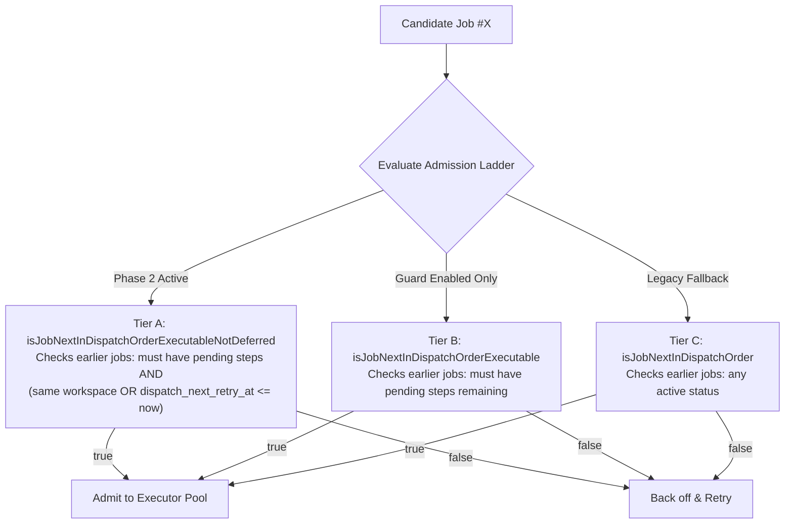

# Terrakube Job Scheduler, Queue & Locking Guide

This guide details how Terrakube orchestrates infrastructure jobs, manages its two-tier queue, enforces global FIFO dispatch ordering via a 3-tier admission ladder, applies bounded dispatch-retry backoff, recovers from node/executor failures, and uses Redis distributed locks across clustered API replicas.

---

## 1. High-Level Architecture & Lifecycle

Terrakube coordinates asynchronous job execution across `terrakube-api`, PostgreSQL, Quartz Scheduler, Redis distributed locks/streams, and `terrakube-executor`.

### End-to-End Execution Flow

```mermaid
flowchart TD
    subgraph JobCreation ["1. Creation & Scheduling"]
        User["User / Webhook / CLI\n(POST /api/v1/job)"] --> Hook["JobManageHook\n(Elide PRECOMMIT / POSTCOMMIT)"]
        Hook --> Svc["ScheduleJobService.createJobContext\n(Creates 30s Quartz trigger: TerrakubeV2_Job_<jobId>)"]
        Svc --> Quartz["Quartz Scheduler\n(Fires ScheduleJob.execute)"]
    end

    subgraph AdmissionAndLocking ["2. Locking & Two-Tier Admission"]
        Quartz --> LockAcq{"Acquire Redis Lock\n(job-execution-lock:<jobId>, TTL 90s)"}
        LockAcq -->|Failed / Contended| SkipTick["Skip Tick (Retry in 30s)"]
        LockAcq -->|Acquired| WsLock{"Workspace Locked?\n(workspace.isLocked && !isOwnPrApplyLock)"}
        WsLock -->|Yes| SkipWsLock["Skip Tick & Emit Gauge\n(countJobsHeldByLockedWorkspace)"]
        WsLock -->|No| WsOrder{"Tier 1: Workspace Active Jobs?\n(Earlier unfinished job on same workspace)"}
        WsOrder -->|Yes (Not Plan-Only)| WaitWs["Wait for Earlier Workspace Job"]
        WsOrder -->|No (or Plan-Only Bypass)| FifoLadder{"Tier 2: Global FIFO Admission Ladder"}
    end

    subgraph AdmissionLadder ["3. 3-Tier Global FIFO Admission Ladder"]
        FifoLadder --> CheckRetry{"dispatch-retry.enabled &&\nadmissionDeferralEnabled?"}
        CheckRetry -->|Yes| QueryA["isJobNextInDispatchOrderExecutableNotDeferred\n(Bypasses earlier jobs in backoff)"]
        CheckRetry -->|No| CheckGuard{"reconciliation.admissionGuardEnabled?"}
        CheckGuard -->|Yes| QueryB["isJobNextInDispatchOrderExecutable\n(Bypasses earlier jobs with 0 pending steps)"]
        CheckGuard -->|No| QueryC["isJobNextInDispatchOrder\n(Classic earliest-ID check)"]
    end

    subgraph DispatchExecution ["4. Dispatch & Execution"]
        QueryA -->|Oldest / Next Eligible| DispatchStep["dispatchStepOrDefer()\n(Acquire VCS token, render step inputs)"]
        QueryB -->|Oldest / Next Eligible| DispatchStep
        QueryC -->|Oldest / Next Eligible| DispatchStep

        DispatchStep -->|VCS Failure & Attempts < 8| Backoff["DispatchRetryCalculator\n(Exponential backoff: 15s -> 900s\nSets dispatch_next_retry_at)"]
        DispatchStep -->|Success| SendExec["ExecutorService.sendJob\n(POST /api/v1/terraform-rs or K8s Job)"]
        SendExec -->|202 Accepted| MarkQueue["Mark Job Status -> 'queue'"]
        MarkQueue --> WakeFIFO["wakeNextDispatchableJob()\n(Wakes next eligible FIFO candidate)"]
        WakeFIFO --> RelLock["Release Redis Lock\n(DEL job-execution-lock:<jobId>)"]
    end

    subgraph RuntimeLifecycle ["5. Runtime Execution & Doorbell"]
        SendExec -.-> ExecPod["terrakube-executor Pod\n(Runs @Async job worker)"]
        ExecPod --> ExecRunning["Mark Job 'running' via API"]
        ExecPod --> Heartbeat["Publish Heartbeat periodically\n(SET executor-job-heartbeat:<jobId>, TTL 30s)"]
        ExecPod --> ExecDone["Complete Terraform execution\n(Update step & job status)"]
        ExecDone --> RelGate["Release ExecutorCapacityGate"]
        RelGate --> Doorbell["Publish Redis Doorbell\n(PUBLISH terrakube:executor-available)"]
    end

    subgraph WakeupAndReconciliation ["6. Low-Latency Wakeup & Recovery"]
        Doorbell --> Listener["ExecutorAvailabilityListener\n(API Redis Pub/Sub subscriber)"]
        Listener --> WakeHead["ScheduleJobService.createJobContextNow\n(Wakes FIFO head in < 5ms)"]
        Sweep["JobReconciliationSweep\n(Quartz 30s background audit)"] --> TriggerRepair["Recreate missing Quartz triggers"]
        Sweep --> HeartbeatAudit["Check executor-job-heartbeat\n(Fail dead jobs after warmup period)"]
        Sweep --> ZeroPending["Reconcile zero-pending jobs\n(JobTerminalStateDeriver)"]
        Sweep --> SpoolRecovery["SpoolRecoveryService\n(Drain spooled structured output)"]
        Inactive["InactiveJobs\n(Quartz sweeper for stuck jobs)"] --> TimeoutAudit["Close runs past maxAgeHours (6h)"]
    end
```

---

## 2. Distributed Execution Lock (`Redis`)

### The Problem
In Quartz Scheduler, `@DisallowConcurrentExecution` on `ScheduleJob` only prevents concurrent executions of the **same** `JobDetail` key. Because Terrakube frequently spawns ad-hoc one-shot triggers via `ScheduleJobService.createJobContextNow` (which creates dynamically suffixed keys `TerrakubeV2_Job_<jobId>_<uuid>`), Quartz would otherwise run recurring ticks and event-driven triggers concurrently across multiple API replicas for the same job.

### Lock Specification & Invariants
* **Unified Lock Key**: `job-execution-lock:<jobId>`
* **TTL**: `90 seconds` (`Duration.ofSeconds(90)`), comfortably exceeding the 70s worst-case HTTP connect (10s) and read (60s) timeouts of `PersistentExecutorService`.
* **Shared Protection**: The lock is shared across all components that process or mutate jobs:
  1. `ScheduleJob` (dispatch and state evaluation)
  2. `InactiveJobs` (stalled job termination)
  3. `JobReconciliationSweep` (heartbeat and trigger remediation)
* **Atomic Acquisition**:
  ```java
  Boolean acquired = redisTemplate.opsForValue()
          .setIfAbsent(EXECUTION_LOCK_PREFIX + jobId, "1", EXECUTION_LOCK_TTL);
  ```
* **Release Timing**:
  - The lock is released **immediately** in the `finally` block once the executor acknowledges dispatch with HTTP `202 Accepted`.
  - **CRITICAL**: The lock is **NEVER** held during the long-running execution of Terraform.
* **Fail-Closed Safety**:
  - If Redis is unreachable, lock acquisition catches `DataAccessException` and returns `false`.
  - The execution skips the current tick and retries on the next 30s cycle, preventing unprotected parallel execution.

---

## 3. Two-Tier Queue Mechanism

Terrakube isolates and serializes jobs across two independent dimensions:

### Tier 1: Per-Workspace Queue (Workspace Serialization)
Within a single workspace, only one state-modifying job may execute at a time:
* **Predecessor Query**:
  `jobRepository.findByWorkspaceAndStatusNotInAndIdLessThan(workspace, TERMINAL_STATUSES, jobId)`.
  If an older job in the workspace is active (`pending`, `approved`, `queue`, `running`, `waitingApproval`), the candidate job backs off.
* **Plan-Only Bypass**:
  Pure speculative plan jobs (`tclService.isTemplatePlanOnly && !tclService.isCliTemplate`) bypass queueing behind older speculative plans, but must still wait if an active `apply` or `destroy` is running on the workspace.
* **Workspace Lockout Semantics (`workspace.isLocked()`)**:
  - If a workspace is locked, `ScheduleJob` skips execution unless the job is the specific run that owns the PR comment lock (`isOwnPrApplyLock(job)`).
  - Skips are tracked via the `countJobsHeldByLockedWorkspace()` gauge (`terrakube.scheduler.executor.queue.locked.skipped`) without holding up the global FIFO queue for other workspaces.

### Tier 2: Executor Capacity Gating
* Persistent executor pods enforce single-tenant concurrency via `ExecutorCapacityGate`.
* When busy, an executor sets its readiness probe to `REFUSING_TRAFFIC` and returns `503 SERVICE_UNAVAILABLE`.
* The API's `PersistentExecutorService` catches the 503 or connection timeout as an `ExecutorUnavailableException`. The scheduler leaves the job in `pending`/`approved` to retry later without failing the run.

---

## 4. Global FIFO Queue & 3-Tier Admission Ladder

### Monotonic Sequential Key
The primary key `id` is a sequential integer generated by PostgreSQL. Lower `id` values represent older, higher-priority jobs.

### The 3-Tier Admission Ladder
Before dispatching a job, `ScheduleJob` evaluates the 3-tier admission query:

```java
boolean admissionGuard = reconciliationProperties.isAdmissionGuardEnabled();
boolean deferralGuard = dispatchRetryProperties.isAdmissionDeferralActive(admissionGuard);
boolean oldest = deferralGuard
        ? jobRepository.isJobNextInDispatchOrderExecutableNotDeferred(job.getId())
        : admissionGuard
            ? jobRepository.isJobNextInDispatchOrderExecutable(job.getId())
            : jobRepository.isJobNextInDispatchOrder(job.getId());
```



### Invariants of the Admission Queries:
1. **Tier A (Dispatch-Retry-Aware)**:
   Earlier jobs that are in dispatch-retry backoff (`dispatch_next_retry_at > now`) still block jobs in their **own** workspace, but **do not block** jobs in other workspaces from claiming idle executor capacity.
2. **Tier B (Guarded Step-Aware)**:
   Earlier jobs in `pending` or `approved` only block the queue if they actually have executable steps remaining (`NOT EXISTS (steps)` or `EXISTS (step.status = 'pending')`). A job with zero pending steps cannot cause head-of-line blocking.
3. **Tier C (Classic)**:
   Strict FIFO across all active jobs.

### Low-Latency Doorbell (Redis Pub/Sub)
1. When an executor finishes a run, it releases its `ExecutorCapacityGate` and publishes an empty message to Redis channel `terrakube:executor-available`.
2. `ExecutorAvailabilityListener` receives the message, queries `jobRepository.findNextDispatchableExecutableNotDeferredJobId()` (or active ladder equivalent), and triggers `ScheduleJobService.createJobContextNow(jobId)`.
3. The next eligible job is dispatched in **< 5 milliseconds**, eliminating the need to wait for the 30-second Quartz polling tick.

---

## 5. Bounded Dispatch-Retry & Backoff

Pre-submission dispatch failures (e.g. VCS access-token acquisition rate limits or transient network failures during VCS discovery) are governed by `DispatchRetryCalculator` (Issues #3665 / #3666):

### Decision Algorithm
```java
public DispatchRetryDecision decide(Job job, Date now, Duration providerRetryAfterHint) {
    int newFailureCount = job.getDispatchFailureCount() + 1;
    Date firstFailureAt = job.getDispatchFirstFailureAt() != null ? job.getDispatchFirstFailureAt() : now;
    long elapsedMinutes = ChronoUnit.MINUTES.between(firstFailureAt.toInstant(), now.toInstant());

    if (newFailureCount >= properties.getMaxAttempts() || elapsedMinutes >= properties.getMaxElapsedMinutes()) {
        return new DispatchRetryDecision(true, newFailureCount, firstFailureAt, null);
    }
    long delaySeconds = backoffSeconds(newFailureCount, providerRetryAfterHint);
    return new DispatchRetryDecision(false, newFailureCount, firstFailureAt,
            Date.from(now.toInstant().plusSeconds(delaySeconds)));
}
```

### Configuration & Backoff Parameters
* **`maxAttempts`**: `8` attempts before failing terminally.
* **`maxElapsedMinutes`**: `60` minutes maximum budget across all retries.
* **`initialBackoffSeconds`**: `15` seconds base delay for attempt 1.
* **Exponential Progression**: $15s \to 30s \to 60s \to 120s \to 240s \to 480s \to 900s$.
* **`maxBackoffSeconds`**: `900` seconds (15 minutes ceiling), also capping provider hints to protect queue liveness.
* **Provider `Retry-After` Support**: Respects upstream VCS rate-limit headers up to `maxBackoffSeconds`.

### Database Columns on `job`
* `dispatch_failure_count` (int): Number of consecutive pre-dispatch failures.
* `dispatch_first_failure_at` (timestamp): Start of the retry window.
* `dispatch_last_attempt_at` (timestamp): Timestamp of the most recent dispatch attempt.
* `dispatch_next_retry_at` (timestamp): Scheduled time before which the job will not be dispatched.
* `dispatch_last_error` (varchar 1024): Sanitized error message describing the failure.

---

## 6. Inactive & Stalled Job Sweeps (`InactiveJobs`)

To prevent orphaned or crashed runs from lingering forever in non-terminal states, `InactiveJobs` runs periodically via Quartz with `@DisallowConcurrentExecution`:

### Sweep Scope & Qualification
* Scans all jobs in `pending`, `approved`, `queue`, and `running`.
* Evaluates `inactiveJobsProperties.expiryOf(job, now, jobRepository)`:
  - **`maxAgeHours` (default: 6 hours)**: Time allowed for execution.
  - **Exclusion of Human Wait Time**: Time spent in `waitingApproval` does not count towards execution age.
  - **Exclusion of Queueing Wait Time**: Time spent waiting behind an earlier active job in the same workspace does not count towards execution age.
  - **`waitingApprovalTimeoutHours` (default: 0 = infinite)**: Optional ceiling on how long a job may wait for human approval before being cancelled.

### Remediation Routine
1. Acquires `job-execution-lock:<jobId>` (90s TTL).
2. Appends `Closed by Terrakube: <reason>` to `job.output`.
3. Sets status to `failed` (or `cancelled` if timed out waiting for approval).
4. Fails any pending steps so notifications reflect the failure cause.
5. Deletes Redis keys and Quartz trigger `TerrakubeV2_Job_<jobId>`.
6. Invokes `jobStatusChangeService.afterStatusChanged(job)`.
7. Updates external VCS commit status checks (GitHub, GitLab, Azure DevOps).

---

## 7. Background Reconciliation, Heartbeat & Spool Recovery

`JobReconciliationSweep` executes every 30 seconds to repair transient inconsistencies:

### 1. Quartz Trigger Repair
* Iterates through active jobs (`pending`, `approved`, `waitingApproval`, `queue`, `running`).
* If an active job has no Quartz trigger (e.g. due to an API crash between trigger deletion and DB commit), re-creates the trigger immediately.

### 2. Executor Heartbeat Expiration
* Executors maintain a periodic heartbeat key in Redis: `executor-job-heartbeat:<jobId>` with a 30-second TTL.
* If a job is in `queue` or `running` and its heartbeat key is missing:
  - Honors `REDIS_WARMUP_PERIOD = 90s` after API/Redis startup to prevent premature termination during cold starts.
  - Marks the job as `failed` with message: `Executor heartbeat expired: executor lost or crashed`.

### 3. Zero-Pending Step Resolution
* Jobs that have completed all steps but failed to transition to a terminal state are resolved using `JobTerminalStateDeriver`:
  - `completed`: All steps completed or no changes.
  - `failed`: At least one step failed.
  - `cancelled`: Step was cancelled.
  - `rejected`: Approval was rejected.

### 4. Structured Output Spool Recovery (`SpoolRecoveryService`)
* If an executor is temporarily unable to reach the API to patch context data, it spools structured output and logs to cloud storage (`StorageTypeService`).
* `SpoolRecoveryService` sweeps pending spool records, applies patches to the database context via `contextWriteService`, updates `step.deliveryState` to `DELIVERED`, and triggers policy evaluation if needed.

### 5. Admin Sweep Endpoint
* `POST /scheduler/reconciliation/run`: Manually triggers an immediate reconciliation pass.
* Protected by `SchedulerReconciliationAccessService`, requiring `EXECUTOR_SERVICE` or platform `instanceOwner` membership.

---

## 8. Configuration & Operational Tuning Reference

All scheduler parameters are configurable in `application.properties`:

| Category | Property | Default | Description |
|---|---|---|---|
| **Reconciliation** | `io.terrakube.api.scheduler.reconciliation.sweepEnabled` | `true` | Master switch for the 30s background reconciliation sweep |
| **Reconciliation** | `io.terrakube.api.scheduler.reconciliation.autoRemediate` | `true` | Enables automatic transition of zero-pending jobs to terminal states |
| **Reconciliation** | `io.terrakube.api.scheduler.reconciliation.admissionGuardEnabled` | `true` | Enables Tier B guarded FIFO queries excluding zero-pending jobs |
| **Reconciliation** | `io.terrakube.api.scheduler.reconciliation.anomalyGraceSeconds` | `300` | Delay before a zero-pending active job is flagged as an anomaly |
| **Dispatch Retry** | `io.terrakube.api.scheduler.dispatch-retry.enabled` | `true` | Master switch for bounded dispatch-retry backoff |
| **Dispatch Retry** | `io.terrakube.api.scheduler.dispatch-retry.maxAttempts` | `8` | Maximum pre-submission dispatch attempts before terminal failure |
| **Dispatch Retry** | `io.terrakube.api.scheduler.dispatch-retry.maxElapsedMinutes` | `60` | Maximum overall elapsed time budget for dispatch retries |
| **Dispatch Retry** | `io.terrakube.api.scheduler.dispatch-retry.initialBackoffSeconds` | `15` | Base delay for first dispatch retry attempt |
| **Dispatch Retry** | `io.terrakube.api.scheduler.dispatch-retry.maxBackoffSeconds` | `900` | Maximum backoff ceiling (15 minutes) |
| **Dispatch Retry** | `io.terrakube.api.scheduler.dispatch-retry.admissionDeferralEnabled` | `true` | Enables Tier A FIFO queries excluding jobs in retry backoff |
| **Inactive Jobs** | `io.terrakube.scheduler.inactive-jobs.maxAgeHours` | `6` | Maximum hours a job may stay open before being failed |
| **Inactive Jobs** | `io.terrakube.scheduler.inactive-jobs.waitingApprovalTimeoutHours` | `0` | Hours a job may wait for approval before cancellation (0 = disabled) |
| **Spool Recovery** | `io.terrakube.scheduler.spool-recovery.enabled` | `true` | Enables recovery of spooled structured output |
| **Spool Recovery** | `io.terrakube.scheduler.spool-recovery.maxBatchSize` | `50` | Maximum spooled records drained per recovery run |
| **Spool Recovery** | `io.terrakube.scheduler.spool-recovery.delaySeconds` | `60` | Initial delay before starting spool recovery tasks |

---

## 9. Verification & Test Suite Reference

Always run the following automated test suites after making changes to the scheduler or queueing logic:

### Core Scheduler & Dispatch Tests
```bash
mvn test -Dtest="ScheduleJobTest,DispatchRetryCalculatorTest,InactiveJobsTest,InactiveJobsPropertiesTest,JobReconciliationServiceTest,JobReconciliationSweepTest"
```

### Full Queue, Metrics & Reconciliation Suite
```bash
mvn test -Dtest="ScheduleJobTest,DispatchRetryCalculatorTest,InactiveJobsTest,InactiveJobsPropertiesTest,JobReconciliationServiceTest,JobReconciliationSweepTest,SchedulerReconciliationAccessServiceTest,SchedulerReconciliationControllerTest,SchedulerThreadPoolValidationTest,ScheduleJobServiceWakeQueueHeadTest,SpoolRecoveryServiceTest,SpoolRecoveryJobTest,SchedulerQueueMetricsTest"
```
