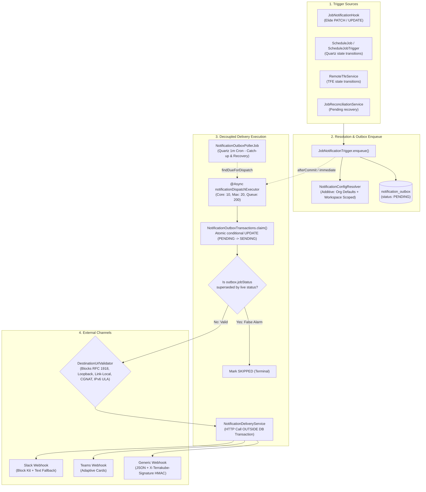

# Terrakube Notification Architecture & Webhook Outbox Guide

Terrakube provides a decoupled, resilient notification engine supporting Slack, Microsoft Teams, and generic HTTP Webhooks triggered by job status transitions across organizations and workspaces.

---

## 1. High-Level Architecture & Delivery Lifecycle



---

## 2. Core Architectural Patterns

### 1. The Transactional Outbox Pattern
* **Decoupled Transactions**: Outbound HTTP requests to external endpoints (Slack, Teams, Webhooks) must **NEVER** run inside a database transaction or hold an open Hibernate connection. Slow or hanging endpoints (10s connect, 30s read) would exhaust the database connection pool.
* **Three-Phase Lifecycle**:
  1. `claim(outboxId)`: Opens a short transaction, executes an atomic conditional update:
     ```sql
     UPDATE notification_outbox 
     SET status = 'SENDING', attempt_count = attempt_count + 1, last_attempt_at = :now
     WHERE id = :outboxId AND status = 'PENDING'
     ```
     Returns 1 for the winning thread/pod, 0 for all others. Zero locking or blocking.
  2. `deliver(claimed)`: Executes the network HTTP call with **no** database transaction active.
  3. `recordResult(outboxId, expectedLastAttemptAt, ...)`: Opens a short transaction to record `SENT` or `FAILED`. Checks `expectedLastAttemptAt` to ensure a reclaimed stuck-row from a sweep does not get overwritten by a lagging response.

### 2. Dual Status Trigger Pathways
1. **Elide JSON:API / GraphQL Hook (`JobNotificationHook`)**:
   * Fires only for updates directly processed by Elide (e.g., API PATCH).
   * Uses `PRECOMMIT` to enqueue outbox rows in the active transaction.
   * Uses `POSTCOMMIT` to dispatch via `notificationDispatchService.dispatchAsync()`.
   * **ThreadLocal Map Isolation**: Keyed by `job.getId()` (`ThreadLocal<Map<Integer, List<UUID>>>`) to prevent concurrent updates on the same thread from clobbering uncommitted outbox IDs.
2. **Quartz & Service Engine Status Changes (`jobNotificationTrigger.notifyStatusChanged()`)**:
   * Direct `jobRepository.save()` in `ScheduleJob`, `ScheduleJobTrigger`, `RemoteTfeService`, or `JobReconciliationService` does not go through Elide.
   * These services invoke `jobNotificationTrigger.notifyStatusChanged(job)` immediately following the save.
   * If a Spring `@Transactional` context is active, it registers a `TransactionSynchronization.afterCommit()` callback; if non-transactional, it dispatches immediately.

### 3. False-Alarm & Transient Failure Suppression
* **The Problem**: During API-to-executor step dispatch, an HTTP connection timeout flips the job to `failed` (`ScheduleJob.errorJobAtStep`). However, the executor often received the job and subsequently callbacks with `running` or `completed`.
* **The Solution**:
  * Jobs transitioning into `RECOVERABLE_STATUSES` (`JobStatus.failed`) have their outbox dispatch deferred by `recoverableStatusGraceSeconds` (default: 90 seconds) via `nextAttemptAt`.
  * The outbox record stores the status it was rendered for in `job_status`.
  * In `NotificationOutboxTransactions.claim()`, `skipSupersededRow()` checks if the job's live status still matches `outbox.getJobStatus()`. If the job transitioned to `running` or `completed`, the row is immediately marked `SKIPPED` with an audit message and suppressed.

### 4. Zero-Trust SSRF Prevention (`DestinationUrlValidator`)
* Authenticated admins configure webhook URLs, but compromised or malicious configurations must not be allowed to pivot against internal cloud metadata (e.g., `169.254.169.254`), container interfaces, or internal cluster services.
* Validates scheme (`http`/`https`), host existence, and resolves all IPs (`InetAddress.getAllByName(host)`).
* Rejects:
  * Loopback addresses (`127.0.0.0/8`, `::1`)
  * RFC 1918 private subnets (`10.0.0.0/8`, `172.16.0.0/12`, `192.168.0.0/16`)
  * Link-local addresses (`169.254.0.0/16`, `fe80::/10`)
  * Multicast & any-local (`0.0.0.0`)
  * Carrier-Grade NAT (`100.64.0.0/10`)
  * IPv6 Unique Local Addresses (`fc00::/7`)
* Re-checked on **every delivery** and during ad-hoc test calls (`/notification/v1/.../test`), preventing port scanning. Can be disabled for internal on-prem relays via `io.terrakube.notification.ssrf.blockPrivateNetworks=false`.

### 5. PostgreSQL Column Mapping: `@Column` Text vs. `@Lob`
* **MANDATE**: Do **NOT** use `@Lob` on String columns like `payload`, `description`, or `last_error`.
* In PostgreSQL, `@Lob` maps to OID-backed Large Object storage, which requires every read/write to occur within an explicit, non-autocommit transaction. Because the Quartz outbox poller runs un-proxied queries, reading `@Lob` fields triggers:
  ```text
  org.postgresql.util.PSQLException: Large Objects may not be used in auto-commit mode.
  ```
* Plain `@Column` mapped to database type `text` in Liquibase avoids OID storage while providing unbounded text storage.

### 6. GraphQL Serialization & Eager Fetching
* In `NotificationConfiguration`:
  ```java
  @ManyToOne(fetch = FetchType.EAGER)
  private Workspace workspace;
  ```
* Reading `configuration.getWorkspace().getId()` via Java getter works on lazy proxies, but Elide GraphQL relationship traversal (`workspace { edges { node { id } } }`) reads the proxy's backing id field directly without triggering initialization, serializing the literal string `"null"`. Eager fetching guarantees the real UUID is serialized.

### 7. Write-Only Security for Secrets
* Notification configurations with signing secrets use Elide's permission model to make secrets strictly write-only:
  ```java
  @ReadPermission(expression = "read notification signing secret")
  @Column(name = "signing_secret")
  private String signingSecret;
  ```
  `ReadNotificationSigningSecret` always returns `false`. The plaintext secret is never serialized in API or GraphQL responses.

### 8. Quartz Poller & AOP Proxying
* Quartz's `SchedulerFactoryBean` instantiates `Job` classes (e.g., `NotificationOutboxPollerJob`, `NotificationOutboxRetentionJob`) via `SpringBeanJobFactory` without wrapping them in Spring AOP proxies.
* Therefore, `@Transactional` declared on a Quartz `Job` class is silently ignored.
* **Mandate**: All transactional database mutations must be delegated to a dedicated Spring `@Service` bean (e.g., `NotificationOutboxTransactions`).

---

## 3. Configuration & Tuning Reference

| Property | Default | Description |
| :--- | :--- | :--- |
| `io.terrakube.notification.dispatch.executor.corePoolSize` | `10` | Core threads for async notification delivery |
| `io.terrakube.notification.dispatch.executor.maxPoolSize` | `20` | Max threads for async notification delivery |
| `io.terrakube.notification.dispatch.executor.queueCapacity` | `200` | Dispatch queue capacity before rejecting to poller |
| `io.terrakube.notification.poller.batchSize` | `200` | Max pending rows processed per poller tick (1 min) |
| `io.terrakube.notification.poller.stuckSendingThresholdMinutes` | `5` | Age before a `SENDING` row is reclaimed as abandoned |
| `io.terrakube.notification.recoverableStatusGraceSeconds` | `90` | Delay before sending notifications for recoverable statuses (`failed`) |
| `io.terrakube.notification.outbox.retentionDays` | `90` | Retention window for terminal rows before daily prune |
| `io.terrakube.notification.ssrf.blockPrivateNetworks` | `true` | Enforces SSRF blocking for notification destination URLs |

---

## 4. Ecosystem Integrations

* **`terrakube-go`**: Provides client models `NotificationConfiguration` and `NotificationTrigger` under `notification_configuration.go` and `notification_trigger.go`.
* **`terrakube-cli`**: Exposes CLI management commands `terrakube notification-configuration` and `terrakube notification-trigger`.
* **`terraform-provider-terrakube`**: Supports Infrastructure-as-Code definitions:
  * Resource: `terrakube_organization_notification_configuration`
  * Resource: `terrakube_workspace_notification_configuration`
  * Data Source: `terrakube_notification_configuration`
* **UI**:
  * Organization-wide notifications: `/organizations/{orgId}/settings/notifications`
  * Workspace-scoped notifications & delivery history: `/organizations/{orgId}/workspaces/{wsId}/settings/notifications`
