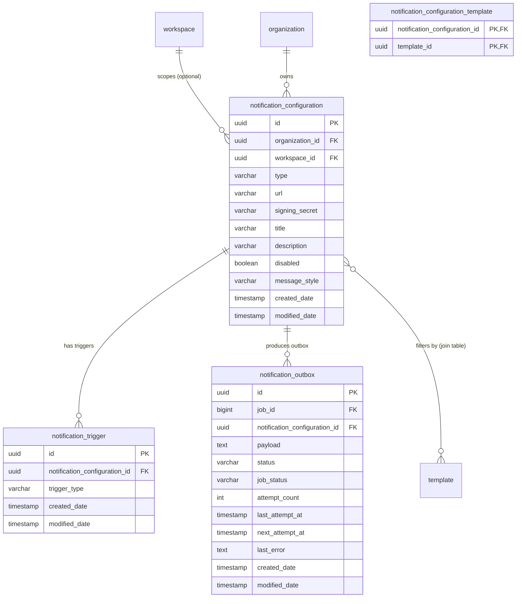

# Terrakube Notification Architecture & Webhook Outbox Guide

Terrakube provides a decoupled, resilient notification engine supporting Slack, Microsoft Teams, and generic HTTP Webhooks triggered by job status transitions across organizations and workspaces.

---

## 1. High-Level Architecture & Delivery Lifecycle

```mermaid
flowchart TD
    subgraph TriggerSources ["1. Trigger Sources"]
        ElideHook["JobNotificationHook\n(Elide PRECOMMIT / POSTCOMMIT)"]
        JobStatusSvc["JobStatusChangeService (#3735)\n(Central status coordinator)"]
        Scheduler["ScheduleJob / ScheduleJobTrigger\n(Quartz state transitions)"]
        Reconciliation["JobReconciliationSweep / InactiveJobs\n(Stuck / sweeping recovery)"]
        SoftDelete["SoftDeleteService\n(Workspace deletion / cleanup)"]
        TFE["RemoteTfeService\n(TFE run state transitions)"]
        PolicyAlert["PolicyNotificationService\n(OPA violation alerts)"]
    end

    subgraph EnqueuePhase ["2. Resolution & Outbox Enqueue"]
        JobStatusSvc --> Trigger["JobNotificationTrigger.notifyStatusChanged()"]
        Scheduler --> JobStatusSvc
        Reconciliation --> JobStatusSvc
        SoftDelete --> JobStatusSvc
        ElideHook --> Trigger
        TFE --> Trigger
        PolicyAlert --> Trigger

        Trigger --> Resolver["NotificationConfigResolver\n(Org Defaults + Workspace Scoped)"]
        Resolver --> FilterTemplate{"Template Filter Match?\n(templates empty OR job.templateReference in templates)"}
        FilterTemplate -->|No| Drop[Ignore configuration]
        FilterTemplate -->|Yes| FailureSummary["JobFailureSummaryService\n(Extracts failing step log tail <= 500 chars)"]
        FailureSummary --> RenderPayload["Render Payload\n(DETAILED card vs. SIMPLE ping)"]
        RenderPayload --> EnqueueOutbox[("notification_outbox\n(status: PENDING, next_attempt_at)")]
    end

    subgraph DispatchExecution ["3. Decoupled Delivery Execution"]
        Trigger -.->|afterCommit / immediate| AsyncThread["@Async notificationDispatchExecutor\n(Core: 10, Max: 20, Queue: 200)"]
        PollerJob["NotificationOutboxPollerJob\n(Quartz 1m Cron - Catch-up & Recovery)"] -.->|findDueForDispatch| AsyncThread

        AsyncThread --> Claim["NotificationOutboxTransactions.claim()\nAtomic conditional UPDATE (PENDING -> SENDING)"]
        Claim --> CheckSuperseded{"Is outbox.jobStatus\nsuperseded by live status?"}
        CheckSuperseded -->|Yes: Recovered / False Alarm| Skip["Mark SKIPPED (Terminal)"]
        CheckSuperseded -->|No: Valid| SSRF{"DestinationUrlValidator\n(Blocks RFC 1918, Loopback, Link-Local, CGNAT, IPv6 ULA)"}
        SSRF -->|Blocked| FailSSRF["Mark FAILED (Terminal, Non-retryable)"]
        SSRF -->|Allowed| Sender["NotificationDeliveryService\n(HTTP Call OUTSIDE DB Transaction)"]
    end

    subgraph Destinations ["4. External Channels & Retry Semantics"]
        Sender --> Slack["Slack Webhook\n(Block Kit + Text Fallback)"]
        Sender --> Teams["Teams Webhook\n(Adaptive Cards)"]
        Sender --> Webhook["Generic Webhook\n(JSON + X-Terrakube-Signature HMAC)"]

        Sender --> HttpResult{"HTTP Response Status"}
        HttpResult -->|2xx Success| Sent["Mark SENT (Terminal)"]
        HttpResult -->|4xx Client Error (excl. 429)| FailClient["Mark FAILED (Terminal, Non-retryable)"]
        HttpResult -->|429 Rate Limit / 5xx / Timeout| RetryCheck{"attempt_count < 3?"}
        RetryCheck -->|Yes| Backoff["Calculate Next Attempt\n(Retry-After header OR 1m / 5m)\nStatus -> PENDING"]
        RetryCheck -->|No: Max Attempts| FailMax["Mark FAILED (Terminal)"]
    end

    subgraph ControlAndTesting ["5. Ad-Hoc Testing & Manual Retry API"]
        TestApi["POST /notification/v1/.../test\n(NotificationTestController)"] --> TestTx["NotificationTestService\n(readOnlyTransactionTemplate closes DB BEFORE HTTP)"]
        TestTx --> SSRF
        RetryApi["POST /notification/v1/workspace/{wsId}/deliveries/{id}/retry\n(NotificationDeliveryController)"] --> Rearm["NotificationOutboxTransactions.rearmForRetry()"]
        Rearm --> AsyncThread
    end
```

---

## 2. Core Architectural & Security Patterns

### 1. The Transactional Outbox Pattern
* **Decoupled Transactions**: Outbound HTTP requests to external endpoints (Slack, Teams, Webhooks) must **NEVER** run inside a database transaction or hold an open Hibernate connection. Slow or hanging external endpoints (e.g., 10s connect, 30s read timeout) would rapidly exhaust the database connection pool.
* **Three-Phase Lifecycle**:
  1. `claim(outboxId)`: Opens a short transaction, executes an atomic conditional update:
     ```sql
     UPDATE notification_outbox 
     SET status = 'SENDING', attempt_count = attempt_count + 1, last_attempt_at = :now
     WHERE id = :outboxId AND status = 'PENDING'
     ```
     Returns 1 for the winning thread/pod, 0 for all others. Zero locking or row contention.
  2. `deliver(claimed)`: Executes the network HTTP call with **no** database transaction active.
  3. `recordResult(outboxId, expectedLastAttemptAt, ...)`: Opens a short transaction to record `SENT` or `FAILED`. Checks `expectedLastAttemptAt` to ensure a reclaimed stuck row from a recovery sweep does not get overwritten by a lagging response.

### 2. Dual Status Trigger Pathways & Centralized Status Coordination
1. **Elide JSON:API / GraphQL Hook (`JobNotificationHook`)**:
   * Fires for updates directly processed through Elide (e.g., UI or API PATCH requests).
   * Uses `PRECOMMIT` to resolve configurations and insert outbox rows within the active transaction.
   * Uses `POSTCOMMIT` to trigger asynchronous dispatch via `notificationDispatchService.dispatchAsync()`.
   * **ThreadLocal Map Isolation**: Keyed by `job.getId()` (`ThreadLocal<Map<Integer, List<UUID>>>`) to prevent concurrent updates on the same thread from clobbering uncommitted outbox IDs.
2. **Centralized Status Coordinator (`JobStatusChangeService`)**:
   * Direct JPA operations (`jobRepository.save()`) outside of Elide—such as in `ScheduleJob`, `ScheduleJobTrigger`, `InactiveJobs`, `JobReconciliationSweep`, and `SoftDeleteService`—must propagate through `JobStatusChangeService`.
   * `JobStatusChangeService` serves as the centralized dispatcher for all post-status-change side effects:
     - Updates `workspace.lastJobStatus`.
     - Publishes live SSE and GraphQL subscription events.
     - Calls `jobNotificationTrigger.notifyStatusChanged(job)`.
3. **Transaction Synchronization Safety**:
   * If a Spring `@Transactional` context is active when `notifyStatusChanged(job)` is called, it registers a `TransactionSynchronization.afterCommit()` callback to ensure outbox rows are committed before workers attempt to read them.
   * If no transaction is active, it dispatches immediately.

### 3. False-Alarm & Transient Failure Suppression
* **The Problem**: During API-to-executor step dispatch, an intermittent HTTP connection timeout or network blip can flip a job to `failed` (`ScheduleJob.errorJobAtStep`). However, the executor often received the job and subsequently issues a callback with `running` or `completed`.
* **The Solution**:
  * Jobs transitioning into `RECOVERABLE_STATUSES` (`JobStatus.failed`) have their outbox dispatch deferred by `recoverableStatusGraceSeconds` (default: 90 seconds) via `nextAttemptAt`.
  * The outbox record stores the status it was rendered for in `job_status`.
  * In `NotificationOutboxTransactions.claim()`, `skipSupersededRow()` checks if the job's live status still matches `outbox.getJobStatus()`. If the job transitioned to `running` or `completed`, the row is immediately marked `SKIPPED` with an audit message and suppressed from sending.

### 4. Zero-Trust SSRF Prevention (`DestinationUrlValidator`)
* Authenticated admins configure webhook URLs, but compromised or malicious configurations must not be allowed to pivot against internal cloud metadata (e.g., `169.254.169.254`), container interfaces, or internal cluster services.
* Validates scheme (`http`/`https`), host existence, and resolves all IPs (`InetAddress.getAllByName(host)`).
* Rejects:
  * Loopback addresses (`127.0.0.0/8`, `::1`)
  * RFC 1918 private subnets (`10.0.0.0/8`, `172.16.0.0/12`, `192.168.0.0/16`)
  * Link-local addresses (`169.254.0.0/16`, `fe80::/10`)
  * Multicast & any-local (`0.0.0.0`)
  * Carrier-Grade NAT (`100.64.0.0/10`)
  * IPv6 Unique Local Addresses (`fc00::/7`)
* Re-checked on **every delivery** and during ad-hoc test calls (`/notification/v1/.../test`), preventing DNS rebinding and internal network port scanning. Can be disabled for internal on-prem relays via `io.terrakube.notification.ssrf.blockPrivateNetworks=false`.

### 5. PostgreSQL Column Mapping: `@Column` Text vs. `@Lob`
* **MANDATE**: Do **NOT** use `@Lob` on String columns like `payload`, `description`, or `last_error`.
* In PostgreSQL, `@Lob` maps to OID-backed Large Object storage, which requires every read/write to occur within an explicit, non-autocommit transaction. Because the Quartz outbox poller runs un-proxied queries, reading `@Lob` fields triggers:
  ```text
  org.postgresql.util.PSQLException: Large Objects may not be used in auto-commit mode.
  ```
* Plain `@Column` mapped to database type `text` in Liquibase avoids OID storage while providing unbounded text storage.

### 6. GraphQL Serialization & Eager Fetching
* In `NotificationConfiguration`:
  ```java
  @ManyToOne(fetch = FetchType.EAGER)
  private Workspace workspace;
  ```
* Reading `configuration.getWorkspace().getId()` via Java getter works on lazy proxies, but Elide GraphQL relationship traversal (`workspace { edges { node { id } } }`) reads the proxy's backing id field directly without triggering initialization, serializing the literal string `"null"`. Eager fetching guarantees the real UUID is serialized.

### 7. Write-Only Security for Secrets
* Notification configurations with signing secrets use Elide's permission model to make secrets strictly write-only:
  ```java
  @ReadPermission(expression = "read notification signing secret")
  @Column(name = "signing_secret")
  private String signingSecret;
  ```
  `ReadNotificationSigningSecret` always returns `false`. The plaintext secret is never serialized in API or GraphQL responses. Outbound webhooks sign JSON payloads with an HMAC SHA-256 header: `X-Terrakube-Signature: sha256=<hex_hmac>`.

### 8. Quartz Poller & AOP Proxying
* Quartz's `SchedulerFactoryBean` instantiates `Job` classes (e.g., `NotificationOutboxPollerJob`, `NotificationOutboxRetentionJob`) via `SpringBeanJobFactory` without wrapping them in Spring AOP proxies.
* Therefore, `@Transactional` declared on a Quartz `Job` class is silently ignored.
* **Mandate**: All transactional database mutations must be delegated to a dedicated Spring `@Service` bean (`NotificationOutboxTransactions`).

### 9. Template Filtering (`notification_configuration_template`)
* Notification configurations can restrict alerts to specific TCL workflow templates via the `ManyToMany` relation `NotificationConfiguration.templates`.
* When `templates` is empty or null, the configuration matches all jobs in the workspace or organization.
* When `templates` contains one or more templates, `NotificationConfigResolver` evaluates `job.getTemplateReference()`. If the job was dispatched with a template not present in the list, no outbox entry is generated.

### 10. Message Style Formatting (`NotificationMessageStyle`)
* Terrakube supports two message formatting modes:
  * `DETAILED` (default): Emits a rich card (Slack Block Kit with Run URL button, Teams Adaptive Card) containing Organization, Workspace, Job ID, Status, Commit, Branch, Author, and Step Failure Summary.
  * `SIMPLE`: Emits a compact, single-line alert formatted as `[STATUS] Organization / Workspace - Job #<id>`.

### 11. Step Failure Log Tail Extraction (`JobFailureSummaryService`)
* For jobs that fail during execution, `JobFailureSummaryService` identifies the failing step in `job.getStep()` and retrieves the console log from storage via `StepOutputReader`.
* The service trims the output to the last 500 characters, sanitizes control characters, and injects the failure reason directly into the notification payload so engineers receive immediate failure context without opening the UI.

### 12. Delivery History & Manual Retry API (`NotificationDeliveryController`)
* Exposes delivery inspection and retry control to workspace operators:
  * `GET /notification/v1/workspace/{workspaceId}/deliveries`: Queries recent delivery records with status, channel, attempt counts, timestamps, and error logs.
  * `POST /notification/v1/workspace/{workspaceId}/deliveries/{deliveryId}/retry`: Re-arms a permanently `FAILED` delivery record via `NotificationOutboxTransactions.rearmForRetry()`:
    - Resets `status` to `PENDING`.
    - Clears `last_error`.
    - Resets `next_attempt_at` to `Instant.now()`.
    - Dispatches immediately via `notificationDispatchService.dispatchAsync()`.

### 13. Ad-Hoc Testing API (`NotificationTestController` & `NotificationTestService`)
* Operators can verify webhook destinations before saving or after modifications:
  * `POST /notification/v1/configuration/{configId}/test`: Tests a saved configuration with a synthetic test event.
  * `POST /notification/v1/organization/{orgId}/notification/test`: Tests a draft/unsaved configuration directly from form inputs.
* **Connection Pool Safety**: `NotificationTestService` uses `readOnlyTransactionTemplate` to initialize required entities and commits/closes the database connection **before** issuing the outbound HTTP network call.
* **SSRF Guard**: Enforces `DestinationUrlValidator` against test URLs, preventing malicious users from utilizing the test endpoint as a port scanner.

### 14. Retry, Backoff & Error Classification Policy
* **Attempt Limit**: Maximum of 3 delivery attempts (`MAX_ATTEMPTS = 3`).
* **Backoff Schedule**:
  * Attempt 1 -> Attempt 2: 1-minute backoff delay.
  * Attempt 2 -> Attempt 3: 5-minute backoff delay.
* **Server-Supplied `Retry-After` Header**:
  * If the destination returns HTTP 429 (Rate Limit) with a `Retry-After` header (e.g. Slack rate limit response), `NotificationDispatchService` parses the integer seconds or RFC 1123 HTTP date and schedules `nextAttemptAt` accordingly, overriding standard backoff delays.
* **Terminal Error Classification**:
  * Non-retryable client errors (HTTP 4xx, except 429) and SSRF rejections are marked `FAILED` immediately without retrying.
  * Server errors (HTTP 5xx), connection timeouts, and read timeouts trigger retry scheduling up to `MAX_ATTEMPTS`.

---

## 3. Data Model, Entities & Database Migrations

### Database Tables & Schema



### Key Indexes & Constraints
1. `notification_configuration`:
   * `idx_notification_configuration_workspace_id` on `(workspace_id)`.
   * `idx_notification_configuration_org_workspace_null` on `(organization_id)` where `workspace_id IS NULL` (indexes organization-default templates).
2. `notification_trigger`:
   * `idx_notification_trigger_configuration_id` on `(notification_configuration_id)`.
3. `notification_outbox`:
   * `idx_notification_outbox_status_last_attempt` on `(status, last_attempt_at)`.
   * Foreign keys to `job` and `notification_configuration` with `ON DELETE CASCADE`.
4. `notification_configuration_template`:
   * Composite primary key on `(notification_configuration_id, template_id)`.

### Liquibase Changelog Reference
* `changelog-2.33.0-notification.xml`: Initial creation of `notification_configuration`, `notification_trigger`, and `notification_outbox`.
* `changelog-2.33.0-notification-outbox-job-id-bigint.xml`: Migration altering `notification_outbox.job_id` from int to bigint to match the primary key type of `job`.
* `changelog-2.33.1-notification-outbox-job-status.xml`: Adds `job_status` to `notification_outbox` for false-alarm suppression and recovery tracking.

---

## 4. Configuration & Tuning Reference

All notification parameters are configurable via `application.properties` or environment variables:

| Property | Default | Description |
| :--- | :--- | :--- |
| `io.terrakube.notification.dispatch.executor.corePoolSize` | `10` | Core thread pool size for async delivery workers |
| `io.terrakube.notification.dispatch.executor.maxPoolSize` | `20` | Max thread pool size for async delivery workers |
| `io.terrakube.notification.dispatch.executor.queueCapacity` | `200` | Dispatch queue capacity before falling back to poller |
| `io.terrakube.notification.poller.batchSize` | `200` | Max pending/retry rows claimed per poller tick (1 minute) |
| `io.terrakube.notification.poller.stuckSendingThresholdMinutes` | `5` | Age threshold before an abandoned `SENDING` row is reclaimed |
| `io.terrakube.notification.recoverableStatusGraceSeconds` | `90` | Grace period delay for recoverable statuses (`failed`) |
| `io.terrakube.notification.outbox.retentionDays` | `90` | Retention window for terminal outbox rows before daily purge |
| `io.terrakube.notification.ssrf.blockPrivateNetworks` | `true` | Enforces zero-trust private/internal IP blocking |

---

## 5. Ecosystem Integrations

* **`terrakube-go`**:
  * Models: `NotificationConfiguration`, `NotificationTrigger` in `notification_configuration.go` and `notification_trigger.go`.
* **`terrakube-cli`**:
  * Commands: `terrakube notification-configuration` and `terrakube notification-trigger` registered through generic resource reflection.
* **`terraform-provider-terrakube`**:
  * `terrakube_organization_notification_configuration`: Org-level notification configurations.
  * `terrakube_workspace_notification_configuration`: Workspace-scoped notification configurations.
  * `terrakube_notification_configuration`: Data source for reading configurations.
* **Terrakube UI (`terrakube/ui`)**:
  * Org Settings: `/organizations/{orgId}/settings/notifications`
  * Workspace Settings: `/organizations/{orgId}/workspaces/{wsId}/settings/notifications`
  * Delivery History & Retry: Workspace delivery table inspecting status, attempts, error messages, and manual retry actions.
  * Ad-Hoc Test Modal: Direct destination testing with live status and response code feedback.
* **OPA Policy Governance (`io.terrakube.api.plugin.policy`)**:
  * Policy sets can bind directly to a dedicated `NotificationConfiguration` (`PolicySet.notificationConfiguration`).
  * `PolicyEvaluationService` and `PolicyNotificationService` stage violation alerts directly into `notification_outbox` whenever hard or soft violations are detected.
  * Policy enforcement state transitions (`waitingApproval` for soft-mandatory, `failed` for hard-mandatory) automatically trigger workspace- and org-level notification triggers.

---

## 6. Verification & Test Suite Reference

Always run the following automated test suites after making changes to the notification subsystem:

### Backend API Tests (`terrakube/api`)
```bash
mvn test -Dtest="JobNotificationTriggerTest,NotificationDispatchServiceTest,NotificationOutboxTransactionsTest,NotificationOutboxPollerJobTest,NotificationOutboxRetentionJobTest,NotificationConfigResolverTest,NotificationTestServiceTest,NotificationConfigurationAccessServiceTest,JobNotificationHookTest,JobFailureSummaryServiceTest,NotificationDeliveryControllerTest,NotificationTestControllerTest,NotificationOutboxRepositoryTest,NotificationDispatchConcurrencyTest"
```

### Frontend UI Tests (`terrakube/ui`)
```bash
CI=true yarn test --watchAll=false \
  src/domain/Notifications/__tests__/NotificationDeliveryHistory.test.tsx \
  src/domain/Notifications/__tests__/NotificationConfigurationList.test.tsx \
  src/domain/Notifications/__tests__/EditNotificationConfiguration.test.tsx \
  src/domain/Workspaces/Settings/__tests__/Notifications.test.tsx
```
