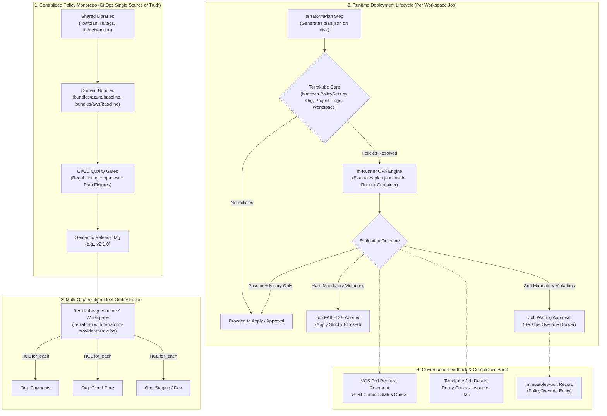
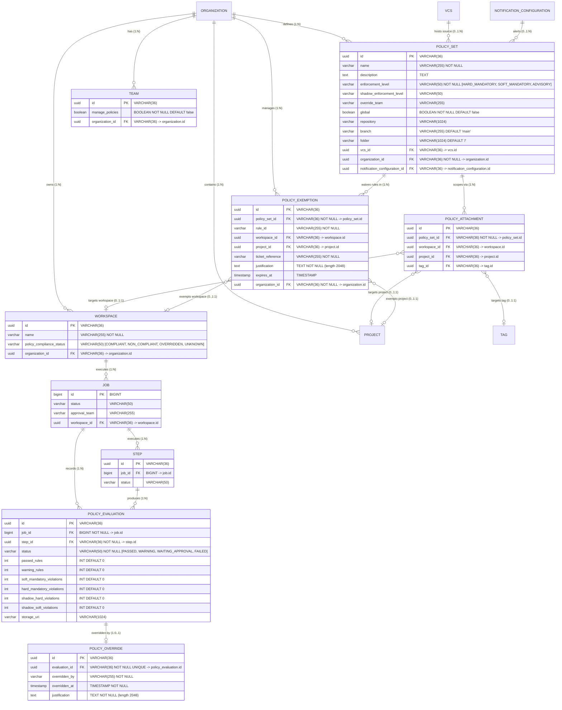
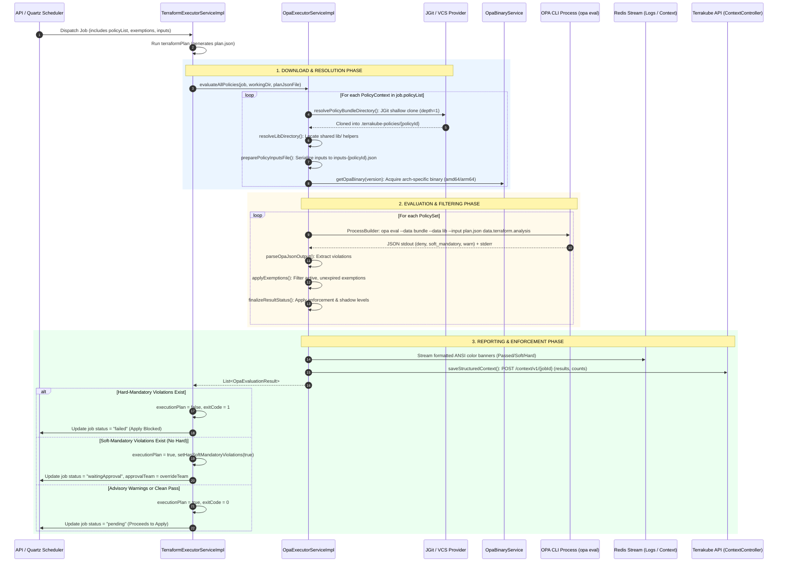

# Terrakube OPA Policy Governance & Fleet Architecture Guide

Terrakube provides centralized Open Policy Agent (OPA) policy governance supporting multi-organization GitOps fleet management, in-runner evaluation against Terraform plan JSON, and three-tier enforcement guardrails.

---

## 1. Architecture Overview



### Core Tenets
1. **Tamper-Proof Governance**: Policies are platform-enforced. Developers cannot delete or bypass policy evaluation by modifying workspace code or workflow template YAML.
2. **Reusability at Scale**: Reusable helper libraries (`lib/`) and modular bundles (`bundles/`) ensure consistent rule enforcement across AWS, Azure, GCP, and Kubernetes without duplicating Rego code.
3. **Infrastructure-as-Code for Policies**: PolicySets and PolicyAttachments are defined and distributed across all Terrakube organizations using Terraform via `terraform-provider-terrakube`.
4. **Safe Phased Rollouts**: Semantic Versioning (`vX.Y.Z`) ensures policy changes are tested in lower environments before being promoted to production organizations.

---

## 2. Domain Models (`io.terrakube.api.rs.policy`)

All policy entities are Yahoo Elide JSON:API resources mapped under `io.terrakube.api.rs.policy`:



* **`PolicySet`** (`@Entity(name = "policy_set")`):
  Defines bundles of Open Policy Agent (Rego) policies linked to a Git VCS repository (`repository`, `branch`, `folder`), enforcement level (`enforcementLevel`), optional `shadowEnforcementLevel`, `overrideTeam`, `global` boolean flag, and `notificationConfiguration`.
* **`PolicyAttachment`** (`@Entity(name = "policy_attachment")`):
  Scopes a `PolicySet` to a specific `workspace`, `project`, or `tag` (mutually exclusive). Global policy sets do not require attachments.
* **`PolicyExemption`** (`@Entity(name = "policy_exemption")`):
  Provides time-bounded rule waivers for a workspace or project (`ruleId`, `ticketReference`, `justification`, `expiresAt`).
* **`PolicyOverride`** (`@Entity(name = "policy_override")`):
  Immutable audit log created when an authorized SecOps team member approves/overrides a `soft_mandatory` violation.
* **`PolicyEvaluation`** (`@Entity(name = "policy_evaluation")`):
  Historical record of policy execution outcomes, violated rules JSON, and timing metrics.

### Entity & Relational Schema Reference

| Entity | Table | Primary Key | Foreign Keys | Relationship & Scoping Invariants |
| :--- | :--- | :--- | :--- | :--- |
| **`PolicySet`** | `policy_set` | `id` (UUID / VARCHAR 36) | `organization_id` (NOT NULL), `vcs_id`, `notification_configuration_id` | Core policy unit configuring VCS repo, enforcement level, override team, and global flag. One-to-many with attachments and exemptions. |
| **`PolicyAttachment`** | `policy_attachment` | `id` (UUID / VARCHAR 36) | `policy_set_id` (NOT NULL), `workspace_id`, `project_id`, `tag_id` | Scopes non-global policy sets to a specific workspace, project, or tag (mutually exclusive). |
| **`PolicyExemption`** | `policy_exemption` | `id` (UUID / VARCHAR 36) | `policy_set_id` (NOT NULL), `organization_id` (NOT NULL), `workspace_id`, `project_id` | Time-bounded rule waiver for specific workspace or project with mandatory ticket reference and justification. |
| **`PolicyEvaluation`** | `policy_evaluation` | `id` (UUID / VARCHAR 36) | `job_id` (BIGINT NOT NULL), `step_id` (UUID NOT NULL) | Records evaluation results for a specific Terraform plan step (`passed`, `warning`, `soft_mandatory`, `hard_mandatory`, `shadow_*`). 1:1 with `PolicyOverride`. |
| **`PolicyOverride`** | `policy_override` | `id` (UUID / VARCHAR 36) | `evaluation_id` (UUID NOT NULL UNIQUE) | Immutable audit log capturing who approved a `soft_mandatory` violation and when, with required justification. |
| **`Workspace`** | `workspace` | `id` (UUID / VARCHAR 36) | `organization_id`, `project_id` | Augmented with `policy_compliance_status` (`COMPLIANT`, `NON_COMPLIANT`, `OVERRIDDEN`, `UNKNOWN`). |
| **`Team`** | `team` | `id` (UUID / VARCHAR 36) | `organization_id` | Augmented with `manage_policies` (BOOLEAN NOT NULL DEFAULT false) permission column. |

---

## 3. Policy API & Controller Endpoints

The OPA Policy Governance subsystem exposes two distinct API planes:

### A. Yahoo Elide JSON:API & GraphQL Plane (`/api/v1` & `/graphql/api/v1`)
All declarative governance entities are managed through Elide JSON:API and GraphQL:

| Endpoint Path | Methods | Resource / Entity | Root-Level? | Elide Security Permissions |
| :--- | :--- | :--- | :--- | :--- |
| `/api/v1/policy_set`<br/>`/api/v1/organization/{orgId}/policySet` | `GET`, `POST`, `PATCH`, `DELETE` | `PolicySet` (`policy_set`) | Yes (`@Include`) | Read: `team view policy set`<br/>Mutations: `team manage policy set` |
| `/api/v1/policy_set/{id}/attachments` | `GET`, `POST`, `PATCH`, `DELETE` | `PolicyAttachment` (`policy_attachment`) | No (`@Include(rootLevel = false)`) | Read: `team view policy attachment`<br/>Mutations: `team manage policy attachment` |
| `/api/v1/policy_exemption`<br/>`/api/v1/organization/{orgId}/policyExemption`<br/>`/api/v1/policy_set/{id}/exemptions` | `GET`, `POST`, `PATCH`, `DELETE` | `PolicyExemption` (`policy_exemption`) | Yes (`@Include`) | Read: `team view policy exemption`<br/>Mutations: `team manage policy exemption` |
| `/api/v1/job/{jobId}/policyEvaluation`<br/>`/api/v1/step/{stepId}/policyEvaluation` | `GET`<br/>(Mutations via service) | `PolicyEvaluation` (`policy_evaluation`) | No (`@Include(rootLevel = false)`) | Read: `team view policy evaluation`<br/>Mutations: `user is a super service` |
| `/api/v1/job/{jobId}/policyEvaluation/{evalId}/override` | `GET`, `POST` | `PolicyOverride` (`policy_override`) | No (`@Include(rootLevel = false)`) | Read: `team view policy override`<br/>Create: `team override policy`<br/>Update/Delete: `user is a super service` |

* **GraphQL Endpoint**: `/graphql/api/v1` supports native querying, filtering, and mutations for all policy entities.
* **Relationship Traversals on Core Entities**:
  * `Organization`: `/api/v1/organization/{id}/policySet`, `/api/v1/organization/{id}/policyExemption`
  * `NotificationConfiguration`: `/api/v1/notificationConfiguration/{id}/policySet`
  * `Job`: `/api/v1/job/{id}/policyEvaluation`
  * `Step`: `/api/v1/step/{id}/policyEvaluation`

### B. Spring MVC Remote State Plane (`RemoteTfeController.java` under `/api/v2`)
Provides TFE CLI and external runner compatibility for runtime policy check evaluation, ANSI log streaming, and SecOps override actions:

| Route & HTTP Method | Request / Response Format | Description & Behavior | RBAC / Authorization |
| :--- | :--- | :--- | :--- |
| `GET /api/v2/runs/{runId}/policy-checks` | `application/vnd.api+json`<br/>-> `PolicyCheckList` | Lists all policy check evaluations for a given run (`Job`). Automatically strips `run-` prefix. | Authenticated via JWT `principal`. Validates user access to organization/workspace. |
| `GET /api/v2/policy-checks/{id}` | `application/vnd.api+json`<br/>-> `PolicyCheckData` | Retrieves single policy check details, violation counts, and status. Automatically strips `polchk-` prefix or parses raw UUID. Returns 404 if not found. | Authenticated via JWT `principal`. |
| `GET /api/v2/policy-checks/{id}/output` | `text/plain` | Streams human-readable ANSI terminal output summarizing passed, advisory, soft-mandatory, and hard-mandatory rules. | Authenticated via JWT `principal`. |
| `POST /api/v2/policy-checks/{id}/actions/override` | Consumes optional JSON:<br/>`{ "justification": "..." }`<br/>Returns: `PolicyCheckData` | Submits SecOps policy override for a check with `soft_mandatory` violations. Creates immutable `PolicyOverride` audit record, transitions evaluation status to `PASSED`, and enables run resumption. Rejects checks with `hard_mandatory` violations (HTTP 400). | Checked via `validateUserCanOverridePolicy`: User must be an Org Admin or member of configured `overrideTeam`. |
| `@ExceptionHandler(IllegalArgumentException.class)` | `application/vnd.api+json`<br/>HTTP 400 | Returns standard JSON:API formatted error envelope on malformed IDs or illegal override attempts. | N/A |

---

## 4. Yahoo Elide Security Checks & Permission Grammar

### Strict Constraint: No Underscores Allowed in Elide Expressions
Yahoo Elide's expression tokenizer treats underscore characters (`_`) as unrecognized tokens, failing with:
```text
token recognition error at: '_'
```
**Mandate**: All `@SecurityCheck(RULE)` annotations and Elide permission expressions (`@ReadPermission`, `@CreatePermission`, `@UpdatePermission`, `@DeletePermission`) MUST use space-separated words without underscores:

```java
@Include
@Getter
@Setter
@Entity(name = "policy_set")
@ReadPermission(expression = "team view policy set")
@CreatePermission(expression = "team manage policy set")
@UpdatePermission(expression = "team manage policy set")
@DeletePermission(expression = "team manage policy set")
public class PolicySet extends GenericAuditFields { ... }
```

### Security Checks Implemented (`io.terrakube.api.rs.checks.policy`)
* `TeamViewPolicySet` (`RULE = "team view policy set"`): Allows read access for organization members or users with limited workspace view rights.
* `TeamManagePolicySet` (`RULE = "team manage policy set"`): Enforces admin rights within the owning organization to create, update, or delete policy sets.
* `TeamViewPolicyAttachment` / `TeamManagePolicyAttachment`: Controls attachment RBAC based on organization membership.
* `TeamOverridePolicy` (`RULE = "team override policy"`): Validates that the user belongs to the `overrideTeam` configured on the violated policy set or possesses organization admin credentials.

---

## 5. Policy Resolution Lifecycle & Non-Transactional Invariants

### 4-Tier Cumulative Resolution (`PolicyResolutionService`)
When Terrakube dispatches a job, `PolicyResolutionService.resolvePoliciesForJob(Job job)` computes the cumulative set of applicable policies in hierarchical order:

1. **Global Baseline**: `policySetRepository.findByOrganizationAndGlobalTrue(org)`
2. **Project-Scoped**: `policyAttachmentRepository.findByProject(project)`
3. **Tag-Scoped**: `workspaceTagRepository.findByWorkspace(workspace)` -> `tagRepository.findAllById(tagUuids)` -> `policyAttachmentRepository.findByTagIn(tags)`
4. **Workspace-Scoped**: `policyAttachmentRepository.findByWorkspace(workspace)`

All policy sets are deduplicated by `PolicySet.id` and sorted alphabetically by name.

### Variable Injection (`Category.POLICY`)
Non-sensitive variables configured with `Category.POLICY` are collected and merged into `PolicyContext.inputs`:
* Organization-level `Globalvar` (Category `POLICY`, non-sensitive).
* Workspace-level `Variable` (Category `POLICY`, non-sensitive).
* Workspace variables override Organization global variables of the same key.

### Critical Quartz Job Invariant: Avoid Lazy Loading Outside Sessions
In Terrakube, `ScheduleJob.doRunExecution` intentionally runs without a surrounding Hibernate transaction so individual repository operations commit independently and the Redis distributed lock (`job-execution-lock:<jobId>`) is released cleanly.

> [!CAUTION]
> **Never Access `@OneToMany` Lazy Collections on Detached Entities in Background Jobs**:
> Calling `job.getWorkspace().getWorkspaceTag()` outside an open session throws:
> `org.hibernate.LazyInitializationException: Cannot lazily initialize collection of role 'io.terrakube.api.rs.workspace.Workspace.workspaceTag' (no session)`.
>
> **Solution**: Always query dedicated Spring Data JPA repositories:
> ```java
> List<WorkspaceTag> workspaceTags = workspaceTagRepository.findByWorkspace(job.getWorkspace());
> ```

---

## 6. Enforcement Levels & Execution Engine

### In-Runner Execution Lifecycle (Download, Evaluate, Report)

OPA evaluations run in-runner inside the executor (both Kubernetes ephemeral containers and persistent runner processes) on `plan.json` immediately following `terraformPlan`:



### Policy Types & Categories Taxonomy

| Dimension | Type / Category | Purpose & Operational Behavior | Typical Use Cases |
| :--- | :--- | :--- | :--- |
| **Enforcement Level**<br/>(`PolicyEnforcementLevel` enum) | **`hard_mandatory`** | **Strict Blocker**: Fails the run immediately (`exitCode = 1`), transitions job to `failed`, and strictly halts Apply. Cannot be overridden. | Non-negotiable security (unencrypted storage, 0.0.0.0/0 ingress), compliance mandates. |
| | **`soft_mandatory`** | **Gated with Override**: Pauses workflow into `waitingApproval`, requires an authorized SecOps team member to submit justification before Apply is unblocked. | Blast radius thresholds, production deployment timing, cross-region infrastructure changes. |
| | **`advisory`** | **Informational Warning**: Emits ANSI yellow warnings and PR comments but never blocks plan or apply. Runs proceed automatically. | Deprecation notices, naming convention suggestions, non-critical hygiene recommendations. |
| **Scoping Hierarchy** | **Global Baseline** | Fleet-wide coverage across all workspaces in the organization (`global = true`). | Base tagging, security hygiene, common blast radius limits. |
| | **Project-Scoped** | Scoped to all workspaces within a business project (`PolicyAttachment.project`). | Departmental policies (e.g. Payments, Data Engineering). |
| | **Tag-Scoped** | Dynamically targeted to workspaces carrying specific tags (`PolicyAttachment.tag`). | Cloud-specific policies (`cloud:azure`), tier policies (`env:prod`). |
| | **Workspace-Scoped** | Explicitly pinned to a single workspace (`PolicyAttachment.workspace`). | Workspace-specific architectural exceptions or unique requirements. |

> [!NOTE]
> **Passive Shadow Evaluation (`shadow_enforcement_level`)**:
> `shadow` is **not** a distinct enum value in `PolicyEnforcementLevel`. Instead, `shadowEnforcementLevel` is an optional entity field on `PolicySet` (`PolicySet.java:L58`) accepting `HARD_MANDATORY` or `SOFT_MANDATORY`. When populated, the executor passively evaluates rules in shadow mode and records informational violation counts (`shadowHardViolations`, `shadowSoftViolations`) without altering the job outcome or blocking execution.

### Soft-Mandatory Approval & Suspension Lifecycle

When a Terraform plan produces soft-mandatory violations without hard-mandatory violations, Terrakube suspends the workflow before `terraformApply`:

```mermaid
sequenceDiagram
    autonumber
    participant Runner as Executor (TerraformExecutorServiceImpl)
    participant OPA as OpaExecutorServiceImpl
    participant Context as JobContextService
    participant Status as UpdateJobStatusImpl
    participant API as Terrakube API (Job Entity)
    participant Quartz as Quartz Scheduler (ScheduleJob)
    participant UI as Terrakube UI (Jobs/Details)

    Runner->>OPA: evaluateAllPolicies(job, plan.json)
    OPA-->>Runner: List<OpaEvaluationResult> (soft > 0, hard == 0)
    OPA->>Context: saveContext("policyEvaluation", payload with aggregate counts)
    Runner->>Runner: Resolve overrideTeam from matching PolicyContext
    Runner->>Status: setCompletedStatus(..., hasSoftMandatoryViolations=true, approvalTeam=overrideTeam)
    Status->>API: updateJob(status="waitingApproval", approvalTeam=overrideTeam)
    Status-->>Quartz: Job status is "waitingApproval"
    Note over Quartz: Quartz ScheduleJob halts dispatch;<br/>terraformApply is NOT scheduled.
    UI->>Context: Fetch /context/v1/{jobId}
    Note over UI: UI displays "Action Required" tag and<br/>"Someone from {approvalTeam} must confirm"
    UI->>API: Override or Approve Job (status="approved")
    Quartz->>API: executeApprovedJobs() dispatches terraformApply
```

#### 1. In-Runner Evaluation & Team Resolution (`TerraformExecutorServiceImpl`)
* After `opaExecutorService.evaluateAllPolicies(...)`:
  - `hasHardViolations`: If any result has `hardMandatoryViolations > 0`, the run fails immediately (`executionPlan = false`, `exitCode = 1`).
  - `hasSoftViolations`: If `softMandatoryViolations > 0` and no hard violations exist, the plan remains valid (`executionPlan = true`), but requires approval.
  - The executor searches `terraformJob.getPolicyList()` for the violated policy set ID to extract its configured `overrideTeam`.
  - Propagates `result.setHasSoftMandatoryViolations(true)` and `result.setApprovalTeam(overrideTeam)`.

#### 2. Structured Context Aggregation (`OpaExecutorServiceImpl`)
* In `saveStructuredContext`, the executor aggregates rule counts across all evaluated policy sets:
  - `softMandatoryViolations`, `hardMandatoryViolations`, `passedRules`, `warningRules`, `shadowHardViolations`, `shadowSoftViolations`.
  - Overall status: `FAILED` (if hard > 0), `WAITING_APPROVAL` (if soft > 0), `WARNING` (if warnings > 0), or `PASSED`.
* Persisted to Redis/MinIO via `JobContextService` under the key `policyEvaluation`.
* The UI (`Details.tsx`) inspects `policyEvaluation.softMandatoryViolations > 0` to render the yellow `"Action Required"` badge and present the approval banner.

#### 3. Job Status Suspension (`UpdateJobStatusImpl`)
* When `isPlan` is true and `hasSoftMandatoryViolations` is set on a successful plan (`exitCode != 1`):
  - Sets `job.status = "waitingApproval"`.
  - Sets `job.approvalTeam = approvalTeam` (e.g., `"SecOps"`).
* Quartz's `ScheduleJob.doRunExecution` checks the job status. Because the status is `"waitingApproval"` rather than `"pending"`, the job falls into the default handler and the next step (`terraformApply`) is **not** scheduled.

#### 4. Approval & Resumption
* **Approval Actions**:
  - Authorized team members can submit a policy override via the UI drawer (`POST /api/v2/runs/{jobId}/policy-checks/actions/override`) with a mandatory justification.
  - Organization admins or members of `approvalTeam` approve the job (setting `status = "approved"`).
* **Resumption**:
  - Quartz detects `job.status == "approved"` and invokes `executeApprovedJobs(job)`, which transitions the job back to `pending` and dispatches `terraformApply`.

### VCS Feedback & PR Comments
`PrCommentService` posts rich Markdown summaries to GitHub/GitLab pull requests:
* Visual status header (Passed / Warning / Failed).
* Table of violations grouped by Policy Set, Rule ID, Severity, and Resource Address.
* Pull request commit status check updated (`pending`, `success`, `failure`).

---

## 7. Terraform Provider Conventions (`terraform-provider-terrakube`)

### Collection Endpoint Naming
Because Elide entities use `@Entity(name = "policy_set")`, Elide exposes them under snake_case endpoints. Provider HTTP client calls must match:
* Correct: `/api/v1/policy_set/{id}/attachments`
* Incorrect: `/api/v1/policySet/{id}/attachments` (causes 404 `Unknown collection policySet`)

### Resource Definitions
* `terrakube_policy_set`:
  ```terraform
  resource "terrakube_policy_set" "blast_radius" {
    organization_id   = data.terrakube_organization.org.id
    name              = "common-blast-radius"
    description       = "Soft mandatory guardrail requiring SecOps override"
    enforcement_level = "soft_mandatory"
    override_team     = "secops"
    vcs_id            = var.vcs_id
    repository        = var.policy_repo
    branch            = "main"
    folder            = "bundles/common/blast_radius" # Note: attribute is folder, NOT path
  }
  ```
* `terrakube_policy_attachment`:
  ```terraform
  resource "terrakube_policy_attachment" "example" {
    policy_set_id = terrakube_policy_set.blast_radius.id
    workspace_id  = terrakube_workspace_cli.compliant.id # Or project_id, or tag_id
  }
  ```
* `terrakube_workspace_cli`:
  Requires `execution_mode`, `iac_type`, and `iac_version`.

### Local Provider Development Override
When validating unreleased provider features locally:
```hcl
# ~/.terraformrc
provider_installation {
  dev_overrides {
    "terrakube-io/terrakube" = "/home/user/go/bin"
  }
  direct {}
}
```
Compile provider using `go build -v -o /home/user/go/bin/terraform-provider-terrakube .`.

---

## 8. Testing & Verification

1. **Policy Bundles**:
   Validate Rego rules with Regal and `opa test`:
   ```bash
   opa test lib/ bundles/ -v
   ```
2. **Backend API**:
   Verify cumulative policy resolution and scheduler non-transactional safety:
   ```bash
   source "$HOME/.sdkman/bin/sdkman-init.sh"
   mvn test -Dtest="PolicyResolutionServiceTest,ScheduleJobTest,PolicyEvaluationServiceTest"
   ```
3. **Fleet Terraform Testing**:
   Run `terraform plan` and `terraform apply` in `terrakube-governance` to provision workspaces, policy sets, and attachments.

---

## 9. Continuous Compliance & Maintenance Schedulers (Drift & Retention)

Terrakube provides two specialized Quartz background jobs to maintain continuous workspace compliance and database audit health:

### 1. Policy Drift Evaluation (`PolicyDriftEvaluationJob`)
* **Purpose**: Detects policy compliance drift across all workspaces when policies are updated, new policy sets are attached, or exemptions expire, without requiring developers to push code or manually trigger a run.
* **Schedule**: Configured via `io.terrakube.policy.drift.cron` (default: `0 0 2 * * ?` -> 2:00 AM daily).
* **Workspace Filtering & Guardrails**:
  1. Skips workspaces that are `deleted`, `locked`, or have status `NeverExecuted`.
  2. Retrieves the latest completed run with a valid `terraformPlan` URL (`findFirstByWorkspaceAndAndStatusInOrderByIdDesc`). If no completed plan exists, the workspace is safely skipped.
  3. Resolves applicable policies using `PolicyResolutionService`. If no policies match, the workspace is skipped.
* **Headless TCL Execution Flow**:
  - Dispatches a lightweight job with `FlowType.policyEvaluation`:
    ```yaml
    flow:
      - type: policyEvaluation
        step: 100
        name: OPA Policy Drift Evaluation
    ```
  - **Executor Optimization**: In `SetupWorkspaceImpl`, the executor detects `"policyEvaluation"` and **bypasses workspace git clone and tarball download**.
  - `OpaExecutorServiceImpl.evaluateJob()` downloads `plan.json` directly from storage and evaluates all policy sets against it.
  - Updates `Workspace.policyComplianceStatus` (`COMPLIANT`, `NON_COMPLIANT`, `OVERRIDDEN`) and records `PolicyEvaluation` entries without altering live workspace state.

### 2. Audit Retention & Pruning (`PolicyEvaluationRetentionJob`)
* **Purpose**: Enforces enterprise data retention policies and prevents unbounded database growth from daily drift evaluations and historical plan runs.
* **Schedule**: Configured via `io.terrakube.policy.evaluation.retentionCron` (default: `0 0 4 * * ?` -> 4:00 AM daily).
* **Retention Window**: Configured via `io.terrakube.policy.evaluation.retentionDays` (default: `90` days).
* **Execution & Cascade Order**:
  1. Computes cutoff timestamp: `System.currentTimeMillis() - (retentionDays * 86,400,000L)`.
  2. First deletes child records: `policyOverrideRepository.deleteByCreatedDateBefore(cutoff)`.
  3. Then deletes parent evaluations: `policyEvaluationRepository.deleteByCreatedDateBefore(cutoff)`.
  4. Runs under `@DisallowConcurrentExecution` to prevent concurrent sweep race conditions.

### Configuration Properties Reference

| Property | Default Value | Description |
| :--- | :--- | :--- |
| `io.terrakube.policy.drift.cron` | `0 0 2 * * ?` | Cron expression for the nightly policy drift evaluation sweep. |
| `io.terrakube.policy.evaluation.retentionCron` | `0 0 4 * * ?` | Cron expression for the nightly policy evaluation retention cleanup sweep. |
| `io.terrakube.policy.evaluation.retentionDays` | `90` | Number of days to retain historical `PolicyEvaluation` and `PolicyOverride` records. |
