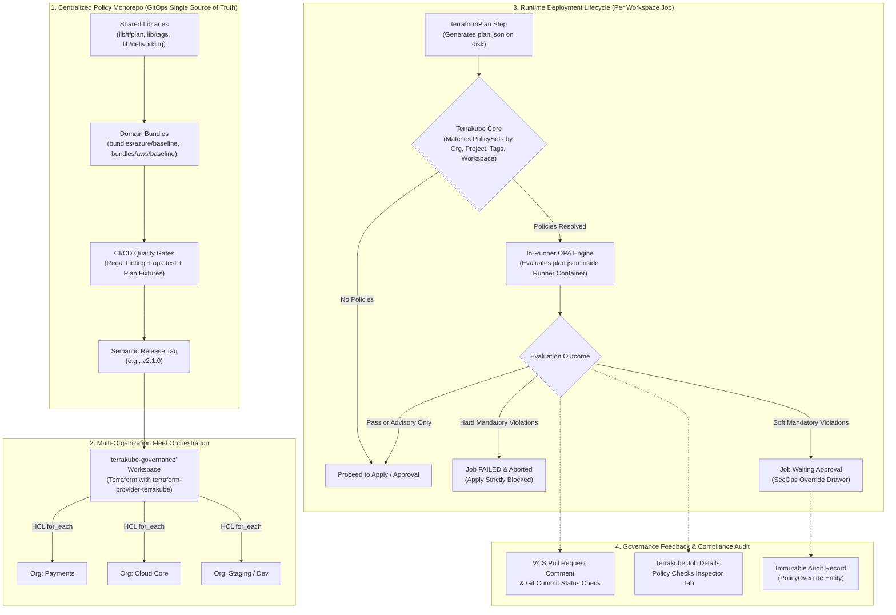

# Terrakube OPA Policy Governance & Fleet Architecture Guide

Terrakube provides centralized Open Policy Agent (OPA) policy governance supporting multi-organization GitOps fleet management, in-runner evaluation against Terraform plan JSON, and three-tier enforcement guardrails.

---

## 1. Architecture Overview



### Core Tenets
1. **Tamper-Proof Governance**: Policies are platform-enforced. Developers cannot delete or bypass policy evaluation by modifying workspace code or workflow template YAML.
2. **Reusability at Scale**: Reusable helper libraries (`lib/`) and modular bundles (`bundles/`) ensure consistent rule enforcement across AWS, Azure, GCP, and Kubernetes without duplicating Rego code.
3. **Infrastructure-as-Code for Policies**: PolicySets and PolicyAttachments are defined and distributed across all Terrakube organizations using Terraform via `terraform-provider-terrakube`.
4. **Safe Phased Rollouts**: Semantic Versioning (`vX.Y.Z`) ensures policy changes are tested in lower environments before being promoted to production organizations.

---

## 2. Domain Models (`io.terrakube.api.rs.policy`)

All policy entities are Yahoo Elide JSON:API resources mapped under `io.terrakube.api.rs.policy`:

* **`PolicySet`** (`@Entity(name = "policy_set")`):
  Defines bundles of Open Policy Agent (Rego) policies linked to a Git VCS repository (`repository`, `branch`, `folder`), enforcement level (`enforcementLevel`), optional `shadowEnforcementLevel`, `overrideTeam`, `global` boolean flag, and `notificationConfiguration`.
* **`PolicyAttachment`** (`@Entity(name = "policy_attachment")`):
  Scopes a `PolicySet` to a specific `workspace`, `project`, or `tag` (mutually exclusive). Global policy sets do not require attachments.
* **`PolicyExemption`** (`@Entity(name = "policy_exemption")`):
  Provides time-bounded rule waivers for a workspace or project (`ruleId`, `ticketReference`, `justification`, `expiresAt`).
* **`PolicyOverride`** (`@Entity(name = "policy_override")`):
  Immutable audit log created when an authorized SecOps team member approves/overrides a `soft_mandatory` violation.
* **`PolicyEvaluation`** (`@Entity(name = "policy_evaluation")`):
  Historical record of policy execution outcomes, violated rules JSON, and timing metrics.

---

## 3. Yahoo Elide Security Checks & Permission Grammar

### Strict Constraint: No Underscores Allowed in Elide Expressions
Yahoo Elide's expression tokenizer treats underscore characters (`_`) as unrecognized tokens, failing with:
```text
token recognition error at: '_'
```
**Mandate**: All `@SecurityCheck(RULE)` annotations and Elide permission expressions (`@ReadPermission`, `@CreatePermission`, `@UpdatePermission`, `@DeletePermission`) MUST use space-separated words without underscores:

```java
@Include
@Getter
@Setter
@Entity(name = "policy_set")
@ReadPermission(expression = "team view policy set")
@CreatePermission(expression = "team manage policy set")
@UpdatePermission(expression = "team manage policy set")
@DeletePermission(expression = "team manage policy set")
public class PolicySet extends GenericAuditFields { ... }
```

### Security Checks Implemented (`io.terrakube.api.rs.checks.policy`)
* `TeamViewPolicySet` (`RULE = "team view policy set"`): Allows read access for organization members or users with limited workspace view rights.
* `TeamManagePolicySet` (`RULE = "team manage policy set"`): Enforces admin rights within the owning organization to create, update, or delete policy sets.
* `TeamViewPolicyAttachment` / `TeamManagePolicyAttachment`: Controls attachment RBAC based on organization membership.
* `TeamOverridePolicy` (`RULE = "team override policy"`): Validates that the user belongs to the `overrideTeam` configured on the violated policy set or possesses organization admin credentials.

---

## 4. Policy Resolution Lifecycle & Non-Transactional Invariants

### 4-Tier Cumulative Resolution (`PolicyResolutionService`)
When Terrakube dispatches a job, `PolicyResolutionService.resolvePoliciesForJob(Job job)` computes the cumulative set of applicable policies in hierarchical order:

1. **Global Baseline**: `policySetRepository.findByOrganizationAndGlobalTrue(org)`
2. **Project-Scoped**: `policyAttachmentRepository.findByProject(project)`
3. **Tag-Scoped**: `workspaceTagRepository.findByWorkspace(workspace)` -> `tagRepository.findAllById(tagUuids)` -> `policyAttachmentRepository.findByTagIn(tags)`
4. **Workspace-Scoped**: `policyAttachmentRepository.findByWorkspace(workspace)`

All policy sets are deduplicated by `PolicySet.id` and sorted alphabetically by name.

### Variable Injection (`Category.POLICY`)
Non-sensitive variables configured with `Category.POLICY` are collected and merged into `PolicyContext.inputs`:
* Organization-level `Globalvar` (Category `POLICY`, non-sensitive).
* Workspace-level `Variable` (Category `POLICY`, non-sensitive).
* Workspace variables override Organization global variables of the same key.

### Critical Quartz Job Invariant: Avoid Lazy Loading Outside Sessions
In Terrakube, `ScheduleJob.doRunExecution` intentionally runs without a surrounding Hibernate transaction so individual repository operations commit independently and the Redis distributed lock (`job-execution-lock:<jobId>`) is released cleanly.

> [!CAUTION]
> **Never Access `@OneToMany` Lazy Collections on Detached Entities in Background Jobs**:
> Calling `job.getWorkspace().getWorkspaceTag()` outside an open session throws:
> `org.hibernate.LazyInitializationException: Cannot lazily initialize collection of role 'io.terrakube.api.rs.workspace.Workspace.workspaceTag' (no session)`.
>
> **Solution**: Always query dedicated Spring Data JPA repositories:
> ```java
> List<WorkspaceTag> workspaceTags = workspaceTagRepository.findByWorkspace(job.getWorkspace());
> ```

---

## 5. Enforcement Levels & Execution Engine

OPA evaluations run in-runner inside the executor (both Kubernetes ephemeral containers and persistent runner processes) on `plan.json` immediately following `terraformPlan`:

| Enforcement Level | Evaluation Outcome | Job Lifecycle & UX Flow |
| :--- | :--- | :--- |
| **`advisory`** | Rule failure detected | Logs warning in ANSI yellow. The run continues automatically to Apply or Approval without interruption. |
| **`soft_mandatory`** | Rule failure detected | Execution pauses. Job transitions to `waitingApproval` with `approvalTeam = overrideTeam`. Authorized SecOps users can approve with a mandatory justification. |
| **`hard_mandatory`** | Rule failure detected | Execution is strictly blocked. Job transitions to `failed`, logs ANSI red errors, exits code 1, and prevents Terraform Apply. |

### VCS Feedback & PR Comments
`PrCommentService` posts rich Markdown summaries to GitHub/GitLab pull requests:
* Visual status header (Passed / Warning / Failed).
* Table of violations grouped by Policy Set, Rule ID, Severity, and Resource Address.
* Pull request commit status check updated (`pending`, `success`, `failure`).

---

## 6. Terraform Provider Conventions (`terraform-provider-terrakube`)

### Collection Endpoint Naming
Because Elide entities use `@Entity(name = "policy_set")`, Elide exposes them under snake_case endpoints. Provider HTTP client calls must match:
* Correct: `/api/v1/policy_set/{id}/attachments`
* Incorrect: `/api/v1/policySet/{id}/attachments` (causes 404 `Unknown collection policySet`)

### Resource Definitions
* `terrakube_policy_set`:
  ```terraform
  resource "terrakube_policy_set" "blast_radius" {
    organization_id   = data.terrakube_organization.org.id
    name              = "common-blast-radius"
    description       = "Soft mandatory guardrail requiring SecOps override"
    enforcement_level = "soft_mandatory"
    override_team     = "secops"
    vcs_id            = var.vcs_id
    repository        = var.policy_repo
    branch            = "main"
    folder            = "bundles/common/blast_radius" # Note: attribute is folder, NOT path
  }
  ```
* `terrakube_policy_attachment`:
  ```terraform
  resource "terrakube_policy_attachment" "example" {
    policy_set_id = terrakube_policy_set.blast_radius.id
    workspace_id  = terrakube_workspace_cli.compliant.id # Or project_id, or tag_id
  }
  ```
* `terrakube_workspace_cli`:
  Requires `execution_mode`, `iac_type`, and `iac_version`.

### Local Provider Development Override
When validating unreleased provider features locally:
```hcl
# ~/.terraformrc
provider_installation {
  dev_overrides {
    "terrakube-io/terrakube" = "/home/user/go/bin"
  }
  direct {}
}
```
Compile provider using `go build -v -o /home/user/go/bin/terraform-provider-terrakube .`.

---

## 7. Testing & Verification

1. **Policy Bundles**:
   Validate Rego rules with Regal and `opa test`:
   ```bash
   opa test lib/ bundles/ -v
   ```
2. **Backend API**:
   Verify cumulative policy resolution and scheduler non-transactional safety:
   ```bash
   source "$HOME/.sdkman/bin/sdkman-init.sh"
   mvn test -Dtest="PolicyResolutionServiceTest,ScheduleJobTest,PolicyEvaluationServiceTest"
   ```
3. **Fleet Terraform Testing**:
   Run `terraform plan` and `terraform apply` in `terrakube-governance` to provision workspaces, policy sets, and attachments.
