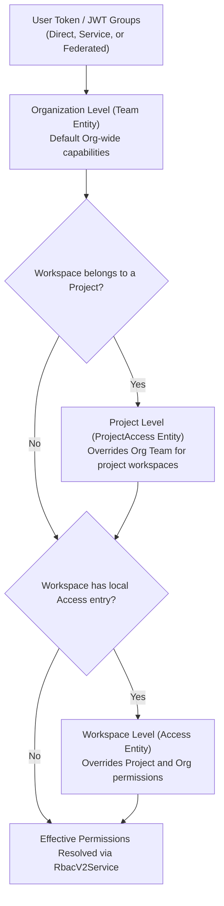

# Terrakube RBAC & Permission Architecture Guide

Terrakube provides role-based and fine-grained access control (RBAC v2) inspired by HCP Terraform, evaluated through `RbacV2Service` (`io.terrakube.api.plugin.security.rbac`), enforced by execution hooks (`JobRunRightsHook`, `JobApprovalHook`), and integrated with Terraform CLI remote execution (`RemoteTfeService`).

---

## 1. 3-Tier Scoping Hierarchy & Precedence

Permissions are evaluated in hierarchical precedence across three distinct scopes:

1. **Workspace Level (`Access`)**: Pinned to a specific Workspace (`access` table). Highest precedence for workspace-scoped actions.
2. **Project Level (`ProjectAccess`)**: Scoped to all workspaces within a Project (`project_access` table). Inherited if no workspace-specific `Access` entry exists for the user's groups.
3. **Organization Level (`Team`)**: Fleet-wide permissions across the Organization (`team` table). Serves as the fallback when no workspace or project access applies, and defines org-wide capabilities (modules, providers, VCS, templates, policies, collections).



### Additive Execution Rights (`JobRunRights`)
For critical execution operations (such as starting an unapproved destroy or approving a run), rights are evaluated **additively**:
```java
allowed = hasOrganizationAccess(user, workspace, ...) 
       || hasWorkspaceAccess(user, workspace, ...) 
       || hasProjectAccess(user, workspace, ...);
```
If **any** tier grants the right through the user's group memberships, the user is permitted to perform the run action.

### Multi-Account Membership Resolution (`MembershipService`)
`MembershipService` checks group membership across all supported identity types:
- **Direct User Accounts**: Evaluated via `groupService.isMember(user, groupName)`.
- **Service Accounts**: Evaluated via `groupService.isServiceMember(user, groupName)`.
- **Federated Machine Accounts**: Evaluated via `groupService.isFederatedMember(user, groupName)` (e.g. GitHub Actions, GitLab CI/CD OIDC tokens).

---

## 2. Predefined Roles & Capability Matrix (`RbacV2Service`)

When `role` is set on `Team`, `ProjectAccess`, or `Access`, it takes precedence over individual boolean flags:

| Role | Core Capabilities | Destroy Right (`canDestroyJob`) | Project Admin (`canManageProject`) | Typical Use Case |
| :--- | :--- | :--- | :--- | :--- |
| **`admin`** | Full control over workspaces, state, templates, VCS, modules, providers, policies, collections, plan, and approve. | **Yes** (`true`) | **Yes** (`true`) | Platform Administrators, SecOps, `TERRAKUBE_ADMIN` |
| **`write`** | Can plan, apply, destroy, manage workspace settings, and read/write state and variables. Cannot manage org modules, templates, collections, policies, or projects. | **Yes** (`true`) | **No** (`false`) | Infrastructure Developers, Service Teams |
| **`plan`** | Can queue plans (including a destroy that waits for an approval). Cannot apply or start an unapproved destroy. Cannot modify workspace settings. | **No** (`false`) | **No** (`false`) | CI/CD pipelines, PR preview automations |
| **`read`** | Read-only access to workspaces, outputs, state, and job logs. Cannot queue runs, apply, destroy, or modify settings. | **No** (`false`) | **No** (`false`) | Auditors, Compliance Officers, Viewers |
| **`custom`** / `null` | Falls back to evaluating fine-grained boolean flags. | Evaluates `destroyJob` (default `true`) | **No** (`false`) | Non-standard or legacy access profiles |

> [!NOTE]
> **Backward Compatibility for Missing Roles**:
> When `role` is null or blank, `RbacV2Service.normalizeRole` defaults to `"custom"`, falling back to evaluating the boolean flags.

### Derived & Specialized Capabilities
- **`canManageJob`**: In RBAC v2, `canManageJob` is derived dynamically as `canPlanJob(t) || canApproveJob(t)`.
- **`canManageProject`**: Available only at the Project tier (`ProjectAccess`). Granted exclusively to the `admin` role; `write`, `plan`, `read`, and `custom` are denied.
- **`canDestroyJob`**: Granted to `admin` and `write`, denied to `plan` and `read`. For `custom`, evaluates the `destroyJob` boolean attribute (which defaults to `true`).

### Comprehensive Role Permission Matrix

| Permission Capability | `admin` | `write` | `plan` | `read` | `custom` Fallback Flag | Tier Applicable |
| :--- | :---: | :---: | :---: | :---: | :--- | :--- |
| **Plan Runs** (`canPlanJob`) | Yes | Yes | Yes | No | `plan_job` | Org, Project, Workspace |
| **Apply Runs** (`canApproveJob`) | Yes | Yes | No | No | `approve_job` | Org, Project, Workspace |
| **Destroy Runs** (`canDestroyJob`) | **Yes** | **Yes** | **No** | **No** | `destroy_job` | Org, Project, Workspace |
| **Manage Workspaces** (`canManageWorkspace`) | Yes | Yes | No | No | `manage_workspace` | Org, Project, Workspace |
| **Manage State** (`canManageState`) | Yes | Yes | No | No | `manage_state` | Org, Project, Workspace |
| **Manage Project** (`canManageProject`) | **Yes** | **No** | **No** | **No** | N/A (Admin only) | Project only |
| **Manage Modules** (`canManageModule`) | Yes | No | No | No | `manage_module` | Org only |
| **Manage Providers** (`canManageProvider`) | Yes | No | No | No | `manage_provider` | Org only |
| **Manage VCS & SSH** (`canManageVcs`) | Yes | No | No | No | `manage_vcs` | Org only |
| **Manage Templates** (`canManageTemplate`) | Yes | No | No | No | `manage_template` | Org only |
| **Manage Policies** (`canManagePolicies`) | Yes | No | No | No | `manage_policies` | Org only |
| **Manage Collections** (`canManageCollection`) | Yes | No | No | No | `manage_collection` | Org only |
| **Manage Job (Composite)** (`canManageJob`) | Yes | Yes | Yes | No | `plan_job \|\| approve_job` | Org, Project, Workspace |

---

## 3. Permission Attributes Reference

### 3.1 Organization Tier: `Team` (`team` table)
Mapped in `io.terrakube.api.rs.team.Team`. Contains all **13** permission attributes:

| Column | Type | Default | Description |
| :--- | :--- | :--- | :--- |
| `role` | VARCHAR(32) | `"custom"` | Predefined role: `admin`, `write`, `plan`, `read`, `custom` |
| `manage_workspace` | BOOLEAN | `false` | Create, rename, and delete workspaces in the organization |
| `manage_module` | BOOLEAN | `false` | Publish and delete registry modules |
| `manage_provider` | BOOLEAN | `false` | Publish and delete registry providers |
| `manage_vcs` | BOOLEAN | `false` | Create and manage VCS provider integrations and SSH keys |
| `manage_template` | BOOLEAN | `false` | Create, update, and delete workflow templates (TCL) |
| `manage_policies` | BOOLEAN | `false` | Create, update, and delete OPA PolicySets and exemptions |
| `manage_state` | BOOLEAN | `false` | Download, upload, view state, and force unlock workspaces |
| `manage_collection` | BOOLEAN | `false` | Create, update, and delete global variable collections |
| `manage_job` | BOOLEAN | `false` | Legacy job management capability (derived in V2) |
| `plan_job` | BOOLEAN | `false` | Queue/run terraform and tofu plan runs |
| `approve_job` | BOOLEAN | `false` | Approve waiting runs and authorize apply execution |
| `destroy_job` | BOOLEAN | `true` | Start an unapproved destroy, auto-approve one, or approve a destroy |

### 3.2 Project Tier: `ProjectAccess` (`project_access` table)
Mapped in `io.terrakube.api.rs.project.access.ProjectAccess`. Scoped to a parent `project_id`:
- `role` (`admin`, `write`, `plan`, `read`, `custom`)
- `manage_workspace`, `manage_state`, `manage_job`, `plan_job`, `approve_job`, `destroy_job` (default `true`)
- Foreign key: `project_id` (references `project(id)` with `deleteCascade = true`)

### 3.3 Workspace Tier: `Access` (`access` table)
Mapped in `io.terrakube.api.rs.workspace.access.Access`. Scoped to a parent `workspace_id`:
- `role` (`admin`, `write`, `plan`, `read`, `custom`)
- `manage_workspace`, `manage_state`, `manage_job`, `plan_job`, `approve_job`, `destroy_job` (default `true`)
- Foreign key: `workspace_id` (references `workspace(id)` with `deleteCascade = true`)

---

## 4. Execution-Time Enforcement & Governance Hooks

Terrakube enforces RBAC rules at multiple stages of the execution lifecycle to ensure unprivileged users cannot trigger unauthorized infrastructure mutations.

### 4.1 Pre-Execution Validation: `JobRunRightsHook`
Runs at Elide's `PREFLUSH` lifecycle phase during job creation (`Operation.CREATE`):
1. **Unapproved Destroy Check**:
   If the job's template destroys without an approval step (`tclService.templateDestroys(template) == WITHOUT_APPROVAL`), the user must have `canDestroy` via `JobRunRights.canDestroy(user, workspace)`.
   If missing, throws `JobRightForbiddenException` with HTTP 403:
   > *"Your teams can plan in workspace \<ws\> but cannot start a run that destroys without an approval step..."*
2. **Unapproved Apply on Restricted Workspaces (`requireApproveToApply`)**:
   If the workspace has `requireApproveToApply = true` and the template applies without an approval step, the user must have `canApprove` via `JobRunRights.canApprove(user, workspace)`.
   If missing, throws `JobRightForbiddenException` with HTTP 403.
3. Because this runs at `PREFLUSH`, refused jobs are **never persisted** to the database.

### 4.2 Pre-Approval Validation: `JobApprovalHook`
Runs at Elide's `PRECOMMIT` phase when updating a job to `status = approved`:
1. **Wait State Verification**: Jobs can only transition to `approved` from `waitingApproval`. Creating a job as `approved` or approving a job while still planning throws `PolicyBlocksApprovalException`.
2. **Destroy Approval Check**: Approving a run whose template destroys (`tclService.templateDestroys(...) != NO`) requires `JobRunRights.canDestroy()`. Users with approve-only rights cannot approve destroy runs.
3. **OPA Policy Gate**: Verifies that no blocking OPA policy evaluations remain (`policyApprovalGuard.blockingReason`).

### 4.3 Workspace Governance Settings (`Workspace.java`)
- **`require_approve_to_apply`** (`requireApproveToApply`, default `false`):
  Opt-in workspace setting requiring the `approve_job` capability even to trigger an apply that has no approval step. Guarded by `@UpdatePermission(expression = "user is a superuser OR team manage workspace")` (only organization-level workspace managers can toggle).
- **`restrict_apply_to_configured_branch`** (`restrictApplyToConfiguredBranch`, default `false`):
  Ensures applies and destroys can only be executed against the configured workspace branch, preventing untrusted branches from mutating production infrastructure.

### 4.4 Terraform CLI Remote Execution (`RemoteTfeService`)
When users execute Terraform via the CLI (`terraform plan`, `terraform apply`, `terraform destroy`):
1. **Capabilities Payload**: Terrakube populates remote execution capabilities based on RBAC:
   - `can-queue-destroy`: requires `validateUserPlanJob && jobRunRights.canDestroy`.
   - `can-queue-apply`: requires `validateUserApproveJob`.
2. **`createRun` Enforcement**:
   - `terraform destroy` (or destroy templates with `autoApply = true`): requires `jobRunRights.canDestroy`.
   - Apply without approval on `requireApproveToApply = true` workspace: requires `jobRunRights.canApprove`.
3. **`applyRun` Enforcement**:
   - Confirming/applying a run that destroys requires `jobRunRights.canDestroy`.

---

## 5. Liquibase Database Migrations & Seed Best Practices

Whenever inserting or updating team access records in Liquibase changelogs or test fixtures, **all 13 permission attributes MUST be populated explicitly**:

### 5.1 Admin Team (`TERRAKUBE_ADMIN` - Full Access)
```xml
<insert tableName="team">
    <column name="id"                value="<UUID>" />
    <column name="name"              value="TERRAKUBE_ADMIN" />
    <column name="role"              value="admin" />
    <column name="manage_workspace"  valueBoolean="true" />
    <column name="manage_module"     valueBoolean="true" />
    <column name="manage_provider"   valueBoolean="true" />
    <column name="manage_vcs"        valueBoolean="true" />
    <column name="manage_template"   valueBoolean="true" />
    <column name="manage_policies"   valueBoolean="true" />
    <column name="manage_state"      valueBoolean="true" />
    <column name="manage_collection" valueBoolean="true" />
    <column name="manage_job"        valueBoolean="true" />
    <column name="plan_job"          valueBoolean="true" />
    <column name="approve_job"       valueBoolean="true" />
    <column name="destroy_job"       valueBoolean="true" />
    <column name="organization_id"   value="<ORG_UUID>" />
</insert>
```

### 5.2 Developer Team (`TERRAKUBE_DEVELOPERS` - Write Role)
```xml
<insert tableName="team">
    <column name="id"                value="<UUID>" />
    <column name="name"              value="TERRAKUBE_DEVELOPERS" />
    <column name="role"              value="write" />
    <column name="manage_workspace"  valueBoolean="true" />
    <column name="manage_module"     valueBoolean="false" />
    <column name="manage_provider"   valueBoolean="false" />
    <column name="manage_vcs"        valueBoolean="false" />
    <column name="manage_template"   valueBoolean="false" />
    <column name="manage_policies"   valueBoolean="false" />
    <column name="manage_state"      valueBoolean="true" />
    <column name="manage_collection" valueBoolean="false" />
    <column name="manage_job"        valueBoolean="true" />
    <column name="plan_job"          valueBoolean="true" />
    <column name="approve_job"       valueBoolean="true" />
    <column name="destroy_job"       valueBoolean="true" />
    <column name="organization_id"   value="<ORG_UUID>" />
</insert>
```

### 5.3 CI/CD Automation Team (Plan-Only Role)
```xml
<insert tableName="team">
    <column name="id"                value="<UUID>" />
    <column name="name"              value="CICD_AUTOMATION" />
    <column name="role"              value="plan" />
    <column name="manage_workspace"  valueBoolean="false" />
    <column name="manage_module"     valueBoolean="false" />
    <column name="manage_provider"   valueBoolean="false" />
    <column name="manage_vcs"        valueBoolean="false" />
    <column name="manage_template"   valueBoolean="false" />
    <column name="manage_policies"   valueBoolean="false" />
    <column name="manage_state"      valueBoolean="false" />
    <column name="manage_collection" valueBoolean="false" />
    <column name="manage_job"        valueBoolean="false" />
    <column name="plan_job"          valueBoolean="true" />
    <column name="approve_job"       valueBoolean="false" />
    <column name="destroy_job"       valueBoolean="false" />
    <column name="organization_id"   value="<ORG_UUID>" />
</insert>
```

---

## 6. Team & Access Management via API & UI

### 6.1 Creating Teams via Elide JSON:API
The `Team` entity requires `user is a superuser` for mutation. Requests must be authenticated with a superuser token (e.g. Dex token belonging to `TERRAKUBE_ADMIN` or matching `io.terrakube.owner`).

* **Endpoint**: `POST /api/v1/organization/{organizationId}/team`
* **Payload**:
```json
{
  "data": {
    "type": "team",
    "attributes": {
      "name": "INFRA_OPERATIONS",
      "role": "write",
      "manageWorkspace": true,
      "manageState": true,
      "manageModule": false,
      "manageProvider": false,
      "manageVcs": false,
      "manageTemplate": false,
      "manageCollection": false,
      "managePolicies": false,
      "manageJob": true,
      "planJob": true,
      "approveJob": true,
      "destroyJob": true
    }
  }
}
```

### 6.2 Managing Project Access
Governed by `team manage project access OR team project limited manage project access`:
* **Endpoint**: `POST /api/v1/project/{projectId}/projectAccess`
* **Payload**:
```json
{
  "data": {
    "type": "projectAccess",
    "attributes": {
      "name": "BILLING_TEAM",
      "role": "plan",
      "manageWorkspace": false,
      "manageState": false,
      "manageJob": false,
      "planJob": true,
      "approveJob": false,
      "destroyJob": false
    }
  }
}
```

### 6.3 Managing Workspace Access
Governed by `team manage workspace access OR team limited manage workspace access`:
* **Endpoint**: `POST /api/v1/workspace/{workspaceId}/access`
* **Payload**:
```json
{
  "data": {
    "type": "access",
    "attributes": {
      "name": "FRONTEND_DEVS",
      "role": "custom",
      "manageWorkspace": false,
      "manageState": true,
      "manageJob": true,
      "planJob": true,
      "approveJob": true,
      "destroyJob": false
    }
  }
}
```

---

## 7. Minting Test JWTs with Custom Group Claims

To test fine-grained RBAC or new group permissions in live clusters without modifying LDAP or Dex user directories, you can mint signed Personal Access Tokens (PAT) carrying arbitrary `groups` claims.

### Token Authentication Mechanics
* Terrakube validates PATs using HMAC-SHA256 against `io.terrakube.token.pat` (`PatSecret`).
* In Kubernetes, the secret value in `terrakube-api-secrets` is base64-encoded, but its underlying content is a base64url-encoded 256-bit key. You must decode base64, then base64url decode with padding:
  ```python
  raw_pat = base64.b64decode(k8s_secret).decode()
  pat_bytes = base64.urlsafe_b64decode(raw_pat + '=' * (-len(raw_pat) % 4))
  ```
* Claims evaluated by `DexGroupServiceImpl.getEffectiveGroups()`:
  * `iss`: `"Terrakube"` (must match `jwtTypePat`)
  * `aud`: `"Terrakube"`
  * `sub`: `"<User Name> (Token)"`
  * `jti`: Random UUID string (or registered PAT UUID in `pat` table)
  * `email`: User email address
  * `name`: User display name
  * `groups`: Array of string group names (e.g. `["INFRA_OPERATIONS"]`)

### Python Helper Script for Minting Tokens

```python
import jwt, datetime, subprocess, base64, uuid

# 1. Retrieve PatSecret from Kubernetes / Minikube
pat_k8s = subprocess.check_output([
    'kubectl', 'get', 'secret',
    'terrakube-api-secrets', '-n', 'terrakube',
    '-o', 'jsonpath={.data.PatSecret}'
]).decode().strip()

# 2. Decode double base64
raw_pat = base64.b64decode(pat_k8s).decode()
pat_bytes = base64.urlsafe_b64decode(raw_pat + '=' * (-len(raw_pat) % 4))

# 3. Mint JWT token
def mint_group_token(email: str, name: str, groups: list[str]) -> str:
    now = datetime.datetime.now(datetime.UTC)
    exp = now + datetime.timedelta(days=30)
    return jwt.encode({
        'iss': 'Terrakube',
        'sub': f'{name} (Token)',
        'aud': 'Terrakube',
        'jti': str(uuid.uuid4()),
        'email': email,
        'email_verified': True,
        'name': f'{name} (Token)',
        'groups': groups,
        'iat': now,
        'exp': exp
    }, pat_bytes, algorithm='HS256', headers={'typ': 'JWT'})

# Example: Generate token for INFRA_OPERATIONS
token = mint_group_token('ops@example.com', 'Operations User', ['INFRA_OPERATIONS'])
```

---

## 8. Verification & Test Suite Reference

When developing, verifying, or debugging RBAC permissions, run the following automated test suites:

### Backend Unit & Integration Tests (`terrakube/api`)
```bash
# Core RBAC role resolution tests
mvn test -Dtest="RbacV2ServiceTest"

# Execution rights and lifecycle hook tests (destroy permission, requireApproveToApply)
mvn test -Dtest="JobRunRightsTest,JobApprovalHookTest,JobRunRightsTests"

# Terraform CLI and Remote execution run rights tests
mvn test -Dtest="RemoteTfeRunRightsTests"
```

### Frontend Tests (`terrakube/ui`)
```bash
# Team role and permissions settings tests
cd terrakube/ui && yarn test --watchAll=false src/domain/Settings/__tests__/TeamPermissionsV2.test.tsx src/domain/Settings/__tests__/EditTeam.test.tsx

# Workspace team access tests
cd terrakube/ui && yarn test --watchAll=false src/domain/Workspaces/Settings/__tests__/TeamAccess.test.tsx
```
