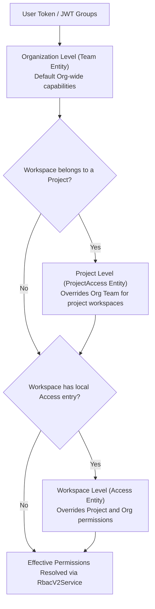

# Terrakube RBAC & Permission Architecture Guide

Terrakube provides role-based and fine-grained access control (RBAC v2) inspired by HCP Terraform, evaluated through `RbacV2Service` (`io.terrakube.api.plugin.security.rbac`).

---

## 1. 3-Tier Scoping Hierarchy

Permissions are evaluated in hierarchical precedence:

1. **Workspace Level (`Access`)**: Pinned to a specific Workspace (`access` table). Highest precedence.
2. **Project Level (`ProjectAccess`)**: Scoped to all workspaces within a Project (`project_access` table). Inherited if no workspace-specific `Access` exists.
3. **Organization Level (`Team`)**: Fleet-wide permissions across the Organization (`team` table).



---

## 2. Predefined Roles (`RbacV2Service`)

When `role` is set on `Team`, `ProjectAccess`, or `Access`, it takes precedence over individual boolean flags:

| Role | Permissions Granted | Typical Use Case |
| :--- | :--- | :--- |
| **`admin`** | Full access to everything (workspace, state, templates, vcs, modules, providers, policies, plan, approve). | Platform Admins, SecOps, `TERRAKUBE_ADMIN` |
| **`write`** | Can plan AND apply jobs, manage state, and update workspace settings. Cannot manage org modules, templates, or policies. | Infrastructure Developers, Service Teams |
| **`plan`** | Can trigger/queue plan jobs and inspect plan output. Cannot apply or modify workspace settings. | CI/CD pipelines, PR preview automations |
| **`read`** | Read-only access to workspaces, outputs, and job logs. Cannot queue jobs or modify settings. | Auditors, Read-only viewers |
| **`custom`** / `null` | Falls back to individual fine-grained boolean flags. | Custom legacy setups requiring non-standard permissions |

---

## 3. Permission Attributes Reference

### Organization Tier: `Team` (`team` table)
Mapped in `io.terrakube.api.rs.team.Team`:

| Column | Type | Description |
| :--- | :--- | :--- |
| `role` | VARCHAR(32) | Predefined role: `admin`, `write`, `plan`, `read`, `custom` |
| `manage_workspace` | BOOLEAN | Create, rename, and delete workspaces in the org |
| `manage_module` | BOOLEAN | Publish and delete registry modules |
| `manage_provider` | BOOLEAN | Publish and delete registry providers |
| `manage_vcs` | BOOLEAN | Create and manage VCS provider integrations |
| `manage_template` | BOOLEAN | Create and edit workflow templates (TCL) |
| `manage_policies` | BOOLEAN | Manage OPA PolicySets, Attachments, and Exemptions |
| `manage_state` | BOOLEAN | Remote state lock/unlock and state version inspection |
| `manage_collection` | BOOLEAN | Create and edit global variable collections |
| `manage_job` | BOOLEAN | Legacy job management capability |
| `plan_job` | BOOLEAN | Queue/run terraform and tofu plan runs |
| `approve_job` | BOOLEAN | Approve waiting runs and authorize SecOps soft-mandatory overrides |

### Project & Workspace Tiers: `ProjectAccess` & `Access`
Mapped in `io.terrakube.api.rs.project.access.ProjectAccess` and `io.terrakube.api.rs.workspace.access.Access`. Both share the workspace-scoped subset:
- `role` (`admin`, `write`, `plan`, `read`, `custom`)
- `manage_workspace`, `manage_state`, `manage_job`, `plan_job`, `approve_job`

---

## 4. Liquibase Seed Data Best Practices

Always specify all 12 attributes explicitly in Liquibase XML:

### Admin Team (Full Access)
```xml
<insert tableName="team">
    <column name="id"                value="<UUID>" />
    <column name="name"              value="TERRAKUBE_ADMIN" />
    <column name="role"              value="admin" />
    <column name="manage_workspace"  valueBoolean="true" />
    <column name="manage_module"     valueBoolean="true" />
    <column name="manage_provider"   valueBoolean="true" />
    <column name="manage_vcs"        valueBoolean="true" />
    <column name="manage_template"   valueBoolean="true" />
    <column name="manage_policies"   valueBoolean="true" />
    <column name="manage_state"      valueBoolean="true" />
    <column name="manage_collection" valueBoolean="true" />
    <column name="manage_job"        valueBoolean="true" />
    <column name="plan_job"          valueBoolean="true" />
    <column name="approve_job"       valueBoolean="true" />
    <column name="organization_id"   value="<ORG_UUID>" />
</insert>
```

### Developer Team (Write Access, Restricted Governance)
```xml
<insert tableName="team">
    <column name="id"                value="<UUID>" />
    <column name="name"              value="TERRAKUBE_DEVELOPERS" />
    <column name="role"              value="write" />
    <column name="manage_workspace"  valueBoolean="true" />
    <column name="manage_module"     valueBoolean="true" />
    <column name="manage_provider"   valueBoolean="true" />
    <column name="manage_vcs"        valueBoolean="true" />
    <column name="manage_template"   valueBoolean="true" />
    <column name="manage_policies"   valueBoolean="false" />
    <column name="manage_state"      valueBoolean="true" />
    <column name="manage_collection" valueBoolean="true" />
    <column name="manage_job"        valueBoolean="true" />
    <column name="plan_job"          valueBoolean="true" />
    <column name="approve_job"       valueBoolean="true" />
    <column name="organization_id"   value="<ORG_UUID>" />
</insert>
```
