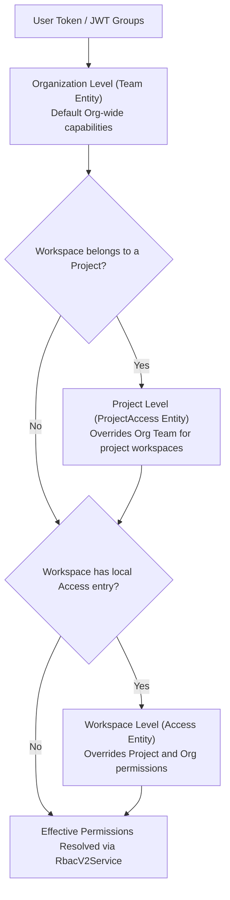
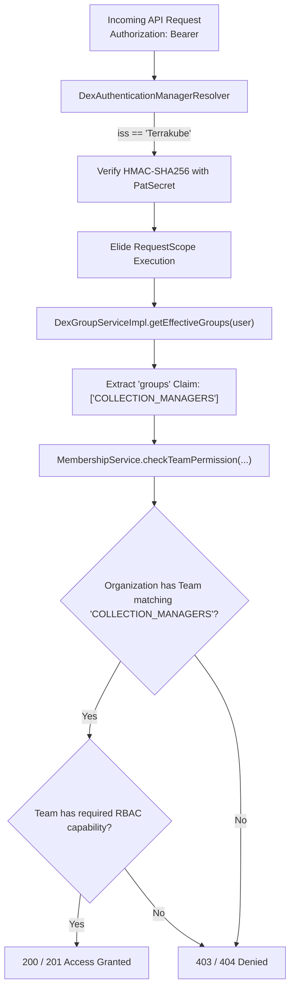

# Terrakube RBAC & Permission Architecture Guide

Terrakube provides role-based and fine-grained access control (RBAC v2) inspired by HCP Terraform, evaluated through `RbacV2Service` (`io.terrakube.api.plugin.security.rbac`).

---

## 1. 3-Tier Scoping Hierarchy

Permissions are evaluated in hierarchical precedence:

1. **Workspace Level (`Access`)**: Pinned to a specific Workspace (`access` table). Highest precedence.
2. **Project Level (`ProjectAccess`)**: Scoped to all workspaces within a Project (`project_access` table). Inherited if no workspace-specific `Access` exists.
3. **Organization Level (`Team`)**: Fleet-wide permissions across the Organization (`team` table).



---

## 2. Predefined Roles (`RbacV2Service`)

When `role` is set on `Team`, `ProjectAccess`, or `Access`, it takes precedence over individual boolean flags:

| Role | Permissions Granted | Typical Use Case |
| :--- | :--- | :--- |
| **`admin`** | Full access to everything (workspace, state, templates, vcs, modules, providers, policies, plan, approve). | Platform Admins, SecOps, `TERRAKUBE_ADMIN` |
| **`write`** | Can plan AND apply jobs, manage state, and update workspace settings. Cannot manage org modules, templates, or policies. | Infrastructure Developers, Service Teams |
| **`plan`** | Can trigger/queue plan jobs and inspect plan output. Cannot apply or modify workspace settings. | CI/CD pipelines, PR preview automations |
| **`read`** | Read-only access to workspaces, outputs, and job logs. Cannot queue jobs or modify settings. | Auditors, Read-only viewers |
| **`custom`** / `null` | Falls back to individual fine-grained boolean flags. | Custom legacy setups requiring non-standard permissions |

---

## 3. Permission Attributes Reference

### Organization Tier: `Team` (`team` table)
Mapped in `io.terrakube.api.rs.team.Team`:

| Column | Type | Description |
| :--- | :--- | :--- |
| `role` | VARCHAR(32) | Predefined role: `admin`, `write`, `plan`, `read`, `custom` |
| `manage_workspace` | BOOLEAN | Create, rename, and delete workspaces in the org |
| `manage_module` | BOOLEAN | Publish and delete registry modules |
| `manage_provider` | BOOLEAN | Publish and delete registry providers |
| `manage_vcs` | BOOLEAN | Create and manage VCS provider integrations |
| `manage_template` | BOOLEAN | Create and edit workflow templates (TCL) |
| `manage_policies` | BOOLEAN | Manage OPA PolicySets, Attachments, and Exemptions |
| `manage_state` | BOOLEAN | Remote state lock/unlock and state version inspection |
| `manage_collection` | BOOLEAN | Create and edit global variable collections |
| `manage_job` | BOOLEAN | Legacy job management capability |
| `plan_job` | BOOLEAN | Queue/run terraform and tofu plan runs |
| `approve_job` | BOOLEAN | Approve waiting runs and authorize SecOps soft-mandatory overrides |

### Project & Workspace Tiers: `ProjectAccess` & `Access`
Mapped in `io.terrakube.api.rs.project.access.ProjectAccess` and `io.terrakube.api.rs.workspace.access.Access`. Both share the workspace-scoped subset:
- `role` (`admin`, `write`, `plan`, `read`, `custom`)
- `manage_workspace`, `manage_state`, `manage_job`, `plan_job`, `approve_job`

---

## 4. Liquibase Seed Data Best Practices

Always specify all 12 attributes explicitly in Liquibase XML:

### Admin Team (Full Access)
```xml
<insert tableName="team">
    <column name="id"                value="<UUID>" />
    <column name="name"              value="TERRAKUBE_ADMIN" />
    <column name="role"              value="admin" />
    <column name="manage_workspace"  valueBoolean="true" />
    <column name="manage_module"     valueBoolean="true" />
    <column name="manage_provider"   valueBoolean="true" />
    <column name="manage_vcs"        valueBoolean="true" />
    <column name="manage_template"   valueBoolean="true" />
    <column name="manage_policies"   valueBoolean="true" />
    <column name="manage_state"      valueBoolean="true" />
    <column name="manage_collection" valueBoolean="true" />
    <column name="manage_job"        valueBoolean="true" />
    <column name="plan_job"          valueBoolean="true" />
    <column name="approve_job"       valueBoolean="true" />
    <column name="organization_id"   value="<ORG_UUID>" />
</insert>
```

### Developer Team (Write Access, Restricted Governance)
```xml
<insert tableName="team">
    <column name="id"                value="<UUID>" />
    <column name="name"              value="TERRAKUBE_DEVELOPERS" />
    <column name="role"              value="write" />
    <column name="manage_workspace"  valueBoolean="true" />
    <column name="manage_module"     valueBoolean="true" />
    <column name="manage_provider"   valueBoolean="true" />
    <column name="manage_vcs"        valueBoolean="true" />
    <column name="manage_template"   valueBoolean="true" />
    <column name="manage_policies"   valueBoolean="false" />
    <column name="manage_state"      valueBoolean="true" />
    <column name="manage_collection" valueBoolean="true" />
    <column name="manage_job"        valueBoolean="true" />
    <column name="plan_job"          valueBoolean="true" />
    <column name="approve_job"       valueBoolean="true" />
    <column name="organization_id"   value="<ORG_UUID>" />
</insert>
```

---

## 5. Team Management via API (Minikube & Live Clusters)

### H2 In-Memory vs. Host PostgreSQL Caveat
In demo environments (such as the default Minikube deployment with `spring_profiles_active: demo` and `ApiDataSourceType: H2`), `terrakube-api` uses an in-memory database. Direct SQL inserts into a local host PostgreSQL (`psql -h localhost -p 5432`) will **not** affect the running Minikube cluster. Teams must be created or updated directly via the Terrakube API.

### Creating Teams via Elide JSON:API
The `Team` entity requires `user is a superuser` for creation, updates, and deletion. Requests must be authenticated with a superuser token (e.g. Dex token belonging to `TERRAKUBE_ADMIN` or matching `io.terrakube.owner`).

All 12 boolean flags and the role must be provided in the payload:

* **Endpoint**: `POST /api/v1/organization/{organizationId}/team`
* **Headers**:
  * `Authorization`: `Bearer <SUPERUSER_DEX_OR_PAT_TOKEN>`
  * `Content-Type`: `application/vnd.api+json`
  * `Accept`: `application/vnd.api+json`
* **Payload**:
```json
{
  "data": {
    "type": "team",
    "attributes": {
      "name": "COLLECTION_MANAGERS",
      "role": "admin",
      "manageCollection": true,
      "manageWorkspace": true,
      "manageModule": true,
      "manageProvider": true,
      "manageVcs": true,
      "manageTemplate": true,
      "manageState": true,
      "manageJob": true,
      "managePolicies": true,
      "planJob": true,
      "approveJob": true
    }
  }
}
```

### Updating Existing Teams
To modify permissions for an existing team (such as granting collection management to `TERRAKUBE_DEVELOPERS`):
* **Endpoint**: `PATCH /api/v1/organization/{organizationId}/team/{teamId}`
* **Payload**:
```json
{
  "data": {
    "type": "team",
    "id": "<TEAM_UUID>",
    "attributes": {
      "manageCollection": true
    }
  }
}
```

---

## 6. Minting Test JWTs with Custom Group Claims

To test fine-grained RBAC or new group permissions in live clusters without modifying LDAP or Dex user directories, you can mint signed Personal Access Tokens (PAT) carrying arbitrary `groups` claims.

### Token Authentication Mechanics
* Terrakube validates PATs using HMAC-SHA256 against `io.terrakube.token.pat` (`PatSecret`).
* In Kubernetes, the secret value in `terrakube-api-secrets` is base64-encoded, but its underlying content is a base64url-encoded 256-bit key. You must decode base64, then base64url decode with padding:
  ```python
  raw_pat = base64.b64decode(k8s_secret).decode()
  pat_bytes = base64.urlsafe_b64decode(raw_pat + '=' * (-len(raw_pat) % 4))
  ```
* Claims evaluated by `DexGroupServiceImpl.getEffectiveGroups()`:
  * `iss`: `"Terrakube"` (must match `jwtTypePat`)
  * `aud`: `"Terrakube"`
  * `sub`: `"<User Name> (Token)"`
  * `jti`: Random UUID string (or registered PAT UUID in `pat` table)
  * `email`: User email address
  * `name`: User display name
  * `groups`: Array of string group names (e.g. `["COLLECTION_MANAGERS"]`)

### Python Helper Script for Minting Tokens

```python
import jwt, datetime, subprocess, base64, uuid

# 1. Retrieve PatSecret from Minikube
pat_k8s = subprocess.check_output([
    'minikube', 'kubectl', '--', 'get', 'secret',
    'terrakube-api-secrets', '-n', 'terrakube',
    '-o', 'jsonpath={.data.PatSecret}'
]).decode().strip()

# 2. Decode double base64
raw_pat = base64.b64decode(pat_k8s).decode()
pat_bytes = base64.urlsafe_b64decode(raw_pat + '=' * (-len(raw_pat) % 4))

# 3. Mint JWT token
def mint_group_token(email: str, name: str, groups: list[str]) -> str:
    now = datetime.datetime.now(datetime.UTC)
    exp = now + datetime.timedelta(days=30)
    return jwt.encode({
        'iss': 'Terrakube',
        'sub': f'{name} (Token)',
        'aud': 'Terrakube',
        'jti': str(uuid.uuid4()),
        'email': email,
        'email_verified': True,
        'name': f'{name} (Token)',
        'groups': groups,
        'iat': now,
        'exp': exp
    }, pat_bytes, algorithm='HS256', headers={'typ': 'JWT'})

# Example: Generate token for COLLECTION_MANAGERS
token = mint_group_token('col_mgr@example.com', 'Collection Manager', ['COLLECTION_MANAGERS'])
```

### Group Resolution Flow


